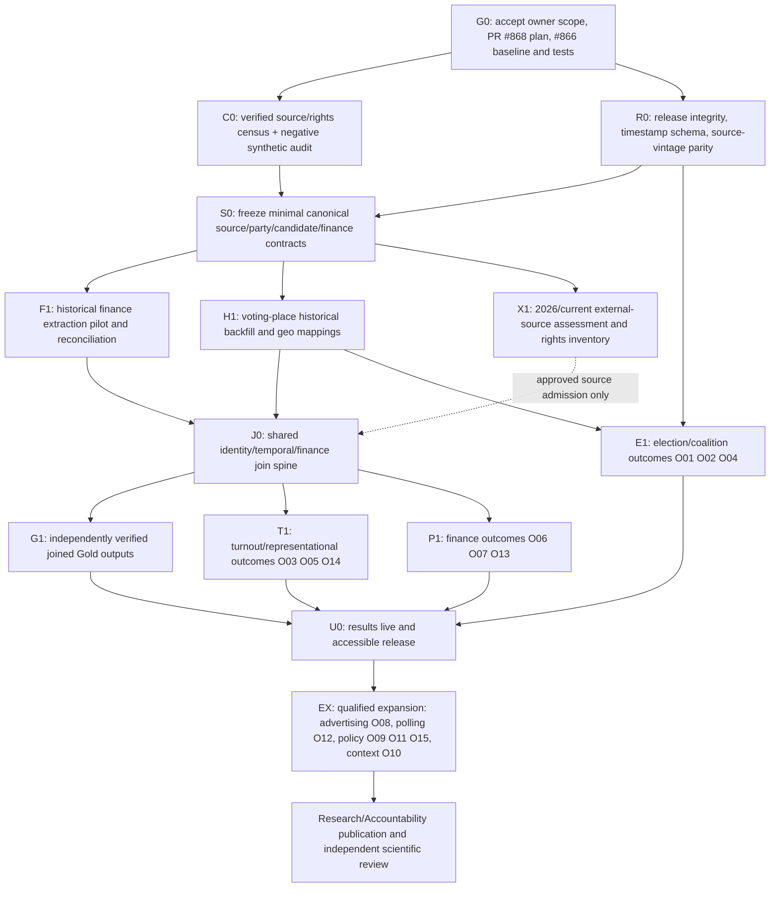

# ChatGPT implementation and integration orchestration — 16 November 2026

**Status: proposed execution strategy; no new worker is commissioned by this document, no new native source has been acquired, and no implementation/publication is accepted.** This subplan belongs to [Election Data Maximisation](index.md) in the existing registered [Election Platform Frontier](../index.md) programme. Research outcomes: [O01–O15](outcomes-and-joins.md). News triggers: [news register](news-issue-register.md). Source constraints: [source register](source-register.md). Finite implementation requirements: [plan](plan.md).

## A. Current entry conditions and ownership (must be re-read before any write)

- Sole PR integration/issue acceptance coordinator: the **existing ordinary ChatGPT coordinator** documented in [issue #867](https://github.com/edithatogo/archive-govt-nz/issues/867). Only that coordinator admits lanes, resolves merge order, merges PRs, verifies receiving `main` and updates shared delivery state.
- Shared elections, dashboard and Conductor implementation owner: existing chat **`6af41384-bab8-8324-ae28-c6219d0c8177`**. Retains ownership of shared `conductor/tracks.md`, active parent tracks, core public election contracts and dashboard release integration. Obtain a durable acknowledgement before assigning any overlapping path.
- PR [#868](https://github.com/edithatogo/archive-govt-nz/pull/868) is the *planning* draft; it is not implemented, accepted or merged. This orchestration belongs to that PR until admitted. Existing PR [#866](https://github.com/edithatogo/archive-govt-nz/pull/866) repairs election/assurance files and is reserved to its owner; **no parallel repair**. Recheck these PRs, source/commit heads and issue #867 afresh; historic head hashes in prior comments are not guaranteed current.
- Respect existing native archive/donor owners and files. No new workers are created automatically by documentation. A separate ChatGPT chat needs an explicit claim through an issue/PR handoff, an actual supported execution environment, and a bounded source/path scope.
- CPython 3.15.1 **repo-local**, uv lock, `AGENTS.md`, `conductor/workflow.md` and all existing CI/privacy/security/rights gates are mandatory. A GitHub connector-only edit or hosted test on 3.15.2 does **not** constitute the required native 3.15.1 `./scripts/validate.sh` qualification.

## B. Orchestration and work-in-progress constraints

| Role | Number active | Responsibility | Exclusive edit boundary |
| --- | ---: | --- | --- |
| **I0 sole coordinator** (existing) | 1 | Owns delivery queue, dependency graph, cross-PR acceptance, shared PR/issue comments, final merges and receiving-main checks | Shared registry and approval; source changes only after separately claiming them |
| **I1 elections/platform owner** (existing) | 1 | Canonical contracts, publication pipeline, shared application glue, integration adapter, dashboard owner consultation | Existing common election/Conductor files; avoid changing #866-owned files |
| **W specialist implementation chats** | **at most 2–3 concurrently** | Deliver bounded non-overlapping slices with tests, PR and exact-head receipt | New lane-specific namespaces agreed before writing |
| **R independent reviewer** | 1 when needed, **read-only** | Reference checks, scientific/methodology inspection and adversarial fixtures independent of author implementation | No source/manifest/shared CI writes |
| **Source-rights authority** | Existing responsible operator | Approves eligibility/licensing, credentials, capture/publish destination and sensitive data disposition where not already authorised | No ChatGPT worker may infer these authorisations from the plan |

**Do not start eight new simultaneous ChatGPT conversations.** Begin with one integration owner + the existing elections owner; admit two independent specialist lanes. Add a third only when owned paths, dependencies and qualified local resources are verified. Reviews are **read-only**, and all coordination is through GitHub/Conductor receipts, not assumptions that chats share live state.

Each workstream has exactly one writer per checkout/worktree/native object. A worker **must stop** if its proposed paths are already modified or claimed, and request a bounded interface handoff rather than edit shared code. Reuse the same chat for repairs and following exact-head review; do not spawn another worker to fix an active worker's PR.

## C. Dependency graph and critical path



**Critical path:** existing merge/CI remediation -> source/rights baseline -> canonical contracts -> independently reconciled first finance/electoral Silver cohorts -> versioned join spine -> question-specific Gold -> public Space/export parity -> sustained refresh. Do not let a model or visualisation PR leapfrog provenance and rights requirements.

**Allowed early parallelism:** C0 source census and R0 publication audit can run independently if each has a distinct owner; planning-only data source/legal review can run alongside both. After S0 contracts are frozen, F1 and H1 can run in parallel in separate namespaces; X1 is read-only until acquisition authority is confirmed. Downstream Gold can start on **qualified individual** inputs without waiting for all historical years; new cohorts continue under the original extraction owners.

## D. Workstream assignment menu — choose at most three specialist lanes

The below paths are **proposed new isolated namespaces**, not proof those paths are free; coordinator verifies the live tree and ownership before authorising each. Parent/shared module and CI edits always return to I1/I0.

| Lane | Wave / executable tasks | Proposed writer-owned paths and boundaries | Prerequisite | Required handoff |
| --- | --- | --- | --- | --- |
| **L00 foundation and synthetic gate** | 0–1; EDM-P00–P04, JOIN-01; source-to-Space audit and rights/coverage census | I1 shared owner; specialist may own **only** new `tests/elections/source_inventory/` or dedicated evidence templates by agreement; no edits to active `materialize_parquet.py` or PR866 paths | Main/PR and owner reconciliation | Versioned coverage matrix, failure receipts, cross-vintage negative tests, pinned source manifest contract |
| **L10 finance archival importer** | 2; EDM-P10–P13, JOIN-04; pilot 2023–2025 party returns, then earlier party/candidate/promoter cohorts | Suggested `src/archive_govt_nz/domains/elections/finance_import/`, `tests/elections/finance_import/`; **no shared core/Silver exporter edits** | Source+rights admit, S0 typed schema, exact original SHA | Per-file extraction/monetary reconciliation, ambiguous rows, raw page references, double-count controls and Gold-ready adapter contract |
| **L20 historical electoral/geography** | 2; EDM-P20–P23, JOIN-03; 2017/2020/2023 place files, roll/turnout, boundary concordance | Suggested `src/archive_govt_nz/domains/elections/historical_import/`, `tests/elections/historical_import/`; **no shared results/publisher edits** | S0 source/party/vintage contract, qualified original archive | 2017/2020/2023 tally parity, covered/uncovered electorate census, weighted crosswalk and no-join-inflation tests |
| **L30 external financial source adapters** | 2 then 6; EDM-P30–P33; 2026 large/aggregate protected donations, broadcast allocations, promoters, digital ads and org registries | Initially source/rights *read-only* assessment; later proposed `src/archive_govt_nz/domains/elections/finance_sources/` and isolated fixture tests; no live browser/production scheduler writes | Specific legal/technical source admission and I1 shared interface | Date- and rule-vintage registration; interval expense amounts, missingness, amendment and identity ambiguity controls |
| **L40 joining kernel and entity registry** | 3; JOIN-02,04–07,09; versioned party/candidate/entity/time/geography mapping and cardinality validation | **I1 shared owner only**, unless a single separate contract owner explicitly receives an exclusive namespace; no parallel shared schema edits | First F1/H1 reference source cohorts and S0 agreed keys | Independent negative tests: vote-vintage mix, alias collision, protected donors, finance duplicate, ad bounds, time/geo join explosion |
| **L50 Gold electoral outcomes** | 4; O01,O02,O04 then O03,O05,O14 and O10 when sourced | Suggested `src/archive_govt_nz/domains/elections/outcomes/results/`, dedicated tests; **do not edit shared Space** | Qualified result vintage, frozen keys, join kernel as needed | Source-vintage-specific vote/seat/turnout metrics, independent electoral fixtures and dashboard view contract |
| **L60 Gold finance and advertising outcomes** | 4/6; O06,O07,O13, followed by O08 when data admitted | Suggested `src/archive_govt_nz/domains/elections/outcomes/finance/`, dedicated tests; no shared Space, donor identity re-identification or fabricated Gini | Qualified finance Silver, donor dedupe, accepted join spine | Disclosed-only metrics, coverage/bounds, ratio denominators, independently reconciled sums |
| **L70 policy, polls and contextual research** | 6–7; O09,O11,O12,O15,O10; later parliamentary links | Suggested `src/archive_govt_nz/domains/elections/outcomes/research/`, **only after source rights**; human-reviewed neutral policy coding | Qualified poll/NZES/policy/Stats NZ/parliament sources and entity/time joins | Neutral source-linked policy comparison, poll scoring, dated descriptive ecology; causal `not_estimated` where unsupported |
| **L80 dashboard and serving integration** | 5 onward; EDM-P40–P43, JOIN-08,10 | **Existing I1 elections/dashboard owner** for `spaces/nz-election-explorer/**` and shared deployment; no specialist edit without handoff | Reconciled Gold slices + source manifest, tested bundle | Mobile/a11y/browser evidence, measured budgets, CSV/Parquet source parity, exact HF served SHA, last-known-good rollback |

### Recommended active roster by wave

| Wave | Writer 1 | Writer 2 | Writer 3 | Integrator/reviewer |
| --- | --- | --- | --- | --- |
| **0: existing CI/ownership** | Existing #866 repair owner only | I1 elections owner: source-release audit (no overlap) | None | I0 handles #868/#866 admission; reviewer read-only |
| **1: reference baseline** | I1 L00 contracts, source manifest | L10 finance *offline fixture/source census only* | L20 historical *offline fixture/source census only* | I0 independent contract intake |
| **2: real existing-data exploitation** | L10 source-qualified finance extraction | L20 source-qualified historical electoral import | L30 external-source rights review **read-only**, or I1 shared adapter | I0 accepts small verified cohorts serially |
| **3: join spine** | I1 L40 identity/join engine | L10 extend older finance cohorts | L20 extend additional valid historical cohorts | Read-only independent reference comparisons |
| **4: first outcomes** | L50 election/turnout Gold | L60 finance Gold | I1 L80 dashboard integration once Gold admitted | I0 serial merges and release gates |
| **5–7: expansion** | L30 admissible 2026/ads source adapter | L70 policy/poll/context Gold | I1 L80 publication/served parity | I0 merges after independent reviews and source gates |

When two lanes discover an interface gap, the **single shared owner** proposes a small canonical change (with tests) before either lane depends on it. The lane needing the change waits or continues unrelated work; no competing schemas or reciprocal edits.

## E. Integrate in this order (branch/PR graph)

0. **Prerequisite:** accept the planning PR #868 into main only after owner/coordinator acknowledgement and required checks. Resolve #866's separate pre-existing CI/format/security findings via its own owner; no administrative bypass. If #868 is held, the planning subplan remains draft and implementation work that depends on its schema/requirements remains unadmitted.
1. **PR-F0 release/source integrity:** single source-vintage/rights/identity minimum; public hard-coded empirical failures caught by tests; last-good publication receipts. I1 owns shared files. Must precede publicly meaningful release.
2. **PR-F1 source inventory and fixture admission:** explicit expected/captured/extracted/reconciled coverage table; qualified small source sets. Can be independent of shared UI after F0 contract agreed.
3. **PR-F2 finance pilot** and **PR-H1 historical voting-place pilot**: **parallel development** against accepted F0 contract, separate PRs. Merge either first when qualified; do not base either on the other's unmerged PR. If both need a shared contract change, integrate that change first.
4. **PR-J0 canonical join spine:** stable party/candidate/organisation/geography/time keys and negative cardinality tests; only after minimally verified source pilots. Freeze a new versioned contract; dependent code targets this accepted main SHA.
5. **PR-E0 electoral Gold** and **PR-P0 finance Gold**: parallel only after relevant F2/H1/J0 evidence. First set: O01–O04 and O06–O07; include O05/O13 only with source/rights and proper semantics. Early feature completeness may be partial but must be labelled.
6. **PR-U0 first public product:** I1 links qualified Gold to a reproducible static bundle, results/finance/atlas panes and time-stamped source status; independent browser and HF readback. Public publication is a separate owner-authorised action, not an automatic consequence of PR merge.
7. **PR-X next-source cohorts** and **PR-R research outcomes:** 2026 filings, ads, company resolution, polling, socioeconomic, policy/Parliament; small source-family PRs in parallel after provenance/join contracts, then staged Gold/UI publication. No single enormous omnibus PR.

**Integration is serial even when implementation is parallel.** Every PR targets current `main` or an explicitly acknowledged upstream base; do not quietly stack behind an unqualified draft. The sole coordinator evaluates semantic cross-PR conflicts, exact-head required checks, and main-after-merge regression. Update dependent branches and rerun their invalidated scopes before subsequent merges; never treat a pass on an older base or SHA as current evidence.

## F. Launch and handoff template for each ChatGPT implementation chat

The **existing** coordinator (not a new duplicate) first records a lane claim in issue #867 or the relevant existing track, including proposed owner chat/UUID, source cohort, exact branch/base SHA, named paths, native object scope, expected output and outstanding external approval. User launches/resumes a **single** worker conversation for that claim; ChatGPT cannot assume it autonomously monitors other conversations or performs background work.

Copy/adapt this concise worker prompt for a selected lane:

> **Archive NZ election data — lane `LXX` / tasks `EDM-Pxx, JOIN-xx, Oxx`.** You are a bounded implementation worker, not the sole integrator. First inspect fresh `edithatogo/archive-govt-nz` main, open PRs, issue #867, the registered `election_platform_frontier_20261111/data_maximisation_20261116/chatgpt-delivery-orchestration.md` and this lane's owner/paths. Stop overlapping writes if existing owners claim them. Own **only** `<exact nonoverlapping source/test paths>`; do not alter shared Conductor, source-release manifests, CI, main, Hugging Face, native capture objects, publication settings or other lanes. Qualify the named `<election-year/source-asset-hashes>` cohort from existing eligible originals and rights. Implement failing focused negative tests first, smallest correct source change using existing Pydantic/Arrow/Polars/DuckDB, then independent source-total and join-cardinality checks. Execute `./scripts/test-focused.sh <affected node>` and `./scripts/validate.sh` using **repo-local CPython 3.15.1** before making a reviewable candidate. Preserve original input hashes, failed receipts, unknown data and privacy restrictions. Open/update **one** PR, do **not** merge. Report branch/head/base SHA, modified files, test commands with actual results, source lineage and rights, empirical/estimated distinctions, assumptions, blockers and dependency interface requests to sole coordinator issue #867. Do not create more workers or start unauthorized source acquisition.

A **review-only** chat must be different: inspect the exact PR/head and independently reproduce numerical totals/joins or adversarial fixtures from pinned inputs; do not commit or merge; publish a scoped finding with reproducible controls, limitations and whether a fix is required. Reviewing generated charts is not a substitute for validating underlying sources.

### Required one-page worker receipt (publish as PR comment)

```yaml
lane: LXX
owner_chat: <actual existing/new chat ID; do not invent>
pr: <URL>
base_sha: <exact SHA>
head_sha: <exact SHA>
exclusive_paths: []
source_cohort:
  eligible_sources: []
  original_sha256: []
  rights_status: qualified|held|unknown
  data_vintage: <label>
tested:
  repo_python: "3.15.1 or NOT QUALIFIED"
  focused: <actual commands + pass/fail/skipped>
  full_validate: <actual command + pass/fail/not_run>
  hosted_checks: <exact run IDs + states>
  independent_reference: <fixture/receipt IDs>
coverage:
  expected: null
  captured: null
  extracted: null
  reconciled: null
join_quality:
  matched: null
  unmatched: null
  duplicate_candidates: null
  cardinality_errors: null
result_status: observed|derived|estimated|research_only|not_ready
published_space_revision: null
blocking_findings: []
coordinator_action: <specific bounded intake, review or interface fix>
```

Do not fill unknown with invented zero; explicit `null` and `not_run` mean not evidenced. If a source is held, perform safe synthetic/offline tests and report the held authority rather than asking for source credentials or circumventing access challenges.

## G. Integration acceptance checklist for the sole coordinator

1. **Ownership and source legitimacy:** one active writer per path; accepted upstream SHA/interface, no unreviewed licensed/sensitive source bytes, no credentials, no unauthorized acquisition/publishing.
2. **Source and calculation:** independent original-source totals, schema, effective historical rules and precise reporting scope; zero synthetic empirical data; versioned 2026 preliminary/official values never mixed.
3. **Join correctness:** primary/foreign keys, cardinality, unmatched/duplicate rates, time/window, party alias, boundaries and donor identity confidence documented; malformed/negative fixtures fail as intended.
4. **Quality:** exact CPython 3.15.1 local focused and full `./scripts/validate.sh` PR profile, with release/mutation stages as required by changed scope; no disabling or laundering existing failures.
5. **Hosted controls:** exact-head and current-base successful applicable GitHub Actions, including required `Assurance (ubuntu-latest)`, `Assurance (macos-latest)`, `Assurance (windows-latest)`, `analyze`, `lint`, plus privacy/security and independently reviewed unresolved thread closure. A green unrelated job is insufficient.
6. **Merge discipline:** the sole coordinator alone merges with GitHub's expected-head SHA, rechecks receiving-main checks and dependent branch bases, records accepted input/output hashes and leaves residual external/source gates open.
7. **Space publication:** source dataset hash -> released Gold hash -> static HTML/export manifest -> served Hugging Face commit/readback. Preserve previous verified revision and fail closed if any parity check fails; do not claim natural recurring refresh without an observed scheduled cycle.
8. **Outcome acceptance:** only mark OIDs complete after QuestionEvidenceReceipt and user-facing inspectable answer/export are verified. The presence of a plan, chart, Parquet path, PR or dataset-card claim does not close an outcome.

## H. Minimal useful release and future expansion

**Release 1** (earliest usable): validated 7 Nov preliminary result vintage, party/seat arithmetic and coalition matrix **O01/O02/O04**; time/status indicator, official-source citation, source release history, CSV/Parquet. Await 27 Nov official figures for official-vintage comparisons; never pretend published in advance.

**Release 2:** historical turnout/electorate comparison **O03**, with coverage and boundary-compatibility warnings. Use already archived voting-place sources.

**Release 3:** **O06/O07** disclosed finance and historical verified spending only for qualified party/year/source cohorts. Present incomplete lower-tail and 2026 not-yet-filed status explicitly.

**Release 4:** staged 2026 financial updates, protected-donation aggregate handling, broadcasting/promoter sources, approved digital ads and O08/O13.

**Release 5:** survey/polls, local election and socioeconomic context O05/O10/O12/O14; later O09/O11/O15 parliamentary/policy accountability with dated primary-source evidence, no implicit donor-policy causal claims.

**Success is source-backed answers available to users, not the maximum number of charts, model claims, or simultaneously active PRs.** Work stops at the accepted selected tranche until the existing coordinator chooses the next qualified increment.
