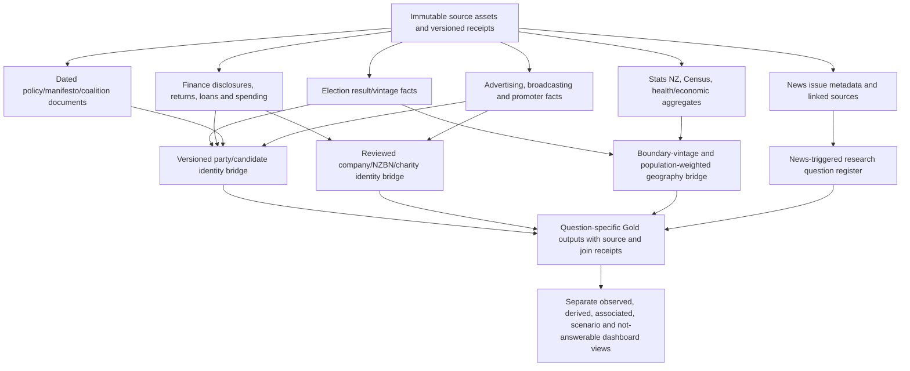

# Outcome-driven research and cross-dataset joins — execution contract

**Status:** proposed analytical products and implementation plan; not a claim of queryable validated datasets or published dashboard capability. Parent programme: [index](../index.md); source register: [source-register](source-register.md); topical triggers: [news issue register](news-issue-register.md). Reviewed against selected 3–15 November 2026 reporting and Electoral Commission 7 November preliminary release. Article claims are leads, not authoritative numeric evidence.

## Evidence classes and release rules

- **O / observed:** source-specific, filed/published original amount/count/policy text; explicit source vintage, coverage and version.
- **D / deterministic derived:** independently reconciled sums, ratios, margins, seat allocation, geographical aggregation or legal-rule counterfactual with declared assumptions.
- **A / descriptive association:** comparisons across harmonised geography/time, controlled for disclosed coverage and compositional differences. **Not causal**.
- **S / scenario/forecast:** prespecified and clearly labelled hypothetical or probabilistic model, with calibration/backtesting and uncertainty; not the official result.
- **C / causal inference:** publish only following independently reviewed identification, estimand, sensitivity, placebo/negative controls and valid empirical observations; otherwise `not_estimated`.
- **X / not answerable:** missing data, unobserved identities, privacy/rights hold, unknown disclosure tail or unvalidated method; surface the reason instead of a fabricated value.

`answerable now` below means source types appear obtainable, **not** that this repository presently has passed a source-to-Gold-to-HF pipeline. Every question starts blocked on verified W0/P0 release integrity until a concrete evidence receipt permits promotion.

## Public question-to-join matrix

| ID | Prioritised reader question / news issue | Required data grain and joins | Evidence tier and answerability | Consumer and independent gate |
| --- | --- | --- | --- | --- |
| **O01** | What governing configurations are arithmetically possible, and which parties are pivotal as special votes are counted? | Party votes and seat allocation by **one** 2026 result vintage -> canonical party IDs -> statutory MMP engine; optional policy/negotiation statements as dated cited context | D now *after parity*; S only if separately calibrated | Results Live; independently confirm 131 seats and 66 majority from 7 Nov provisional results; exclude politically implausible claims as arithmetic certainty |
| **O02** | Which results actually change between provisional, advance-vote and official counts? | 2026 vote totals by election, vintage, electorate, party and candidate; voting place where supported; 2017–2023 historic vintages for descriptive benchmark | D after official release (expected 27 Nov); S for pre-release speculation | Results Live; no cross-vintage mixed totals; preserve 7 Nov archive; independent diff and rounding controls |
| **O03** | Why has turnout fallen, and where are changes concentrated? | Enrolment and turnout by **denominator date**, year, electorate and permitted age/roll aggregate; boundary-vintage bridge to Stats NZ 2023 populations; 1996–2023 comparison | D/A; mechanism/individual non-voting motives X absent representative survey | Historical Atlas; quantify expected, missing and mapping-uncertain geographies and distinguish estimated 2026 vs verified historical turnout |
| **O04** | Are smaller parties gaining relative representation or bargaining power? | Canonical party lineage 1996–2026 -> party vote/seat facts -> coalition arithmetic and power-index calculation; supplementary polls/NZES | D historical fragmentation and seat disproportionality; A comparison; no causal assumption from aggregate party movement | Results Live / Polling Lab; all parties including zero-seat party votes in vote-based denominators |
| **O05** | How have Māori roll enrolment, Māori electorates and parliamentary representation changed? | Official roll aggregate by enrolment/vintage + electorate returns + public MP roster/published self-described representation + valid geography/policy sources | D/A at aggregate/public-role level; individual voting and inferred ethnicity X | Historical Atlas / Accountability; no identification from names, no extrapolation from roll to individual Māori voting or demographic determinism |
| **O06** | How concentrated is publicly disclosed political funding and how does it vary by party/year? | Annual donations/loans + 2026 immediate declarations + Commission **protected-donation quarterly aggregate/payout** tables -> canonical party/time/filing; reviewed organisation donor identities and threshold regime | D for *disclosed/observed* amounts only; unknown anonymous donor identities X | Finance Explorer; effective-dated rules, duplicate declarations, incomplete lower tail and uncertainty; no de-anonymisation |
| **O07** | What did parties, candidates and promoters actually spend, compared with votes or seats? | Actual party/candidate/promoter filed expenses (different scopes) + broadcasting allocations vs actual broadcast costs + results by same election/party/candidate; CPI period | D for past **filed** elections; 2026 full election expense X until 2027 returns published | Finance / Advertising; do not count allocations as spent or call correlations ROI/causal; prevent double counting |
| **O08** | What campaigning took place on digital platforms, and how do spending ranges compare with disclosed promoter and party figures? | Meta/Google ad ID/platform/date/advertiser + approved promoter/party entity crosswalk + actual regulated-period filings, when available | D only for platform reported bands, A for aggregate patterns; total all-platform ad spend X | Advertising Observatory; report coverage, non-comparable impressions and bounded spend; no voter targeting profiles |
| **O09** | What did parties propose on donations, lobbying and integrity, and what legislation followed? | Versioned manifesto/policy statements by party/topic/date + transparently sourced survey answers + future parliamentary bills/divisions + election results | O/D for documented commitments and enacted outcomes; donor-policy causation X | Accountability Explorer; document party silence vs absence, record reversals/date, no corruption inference |
| **O10** | How do economic pressures relate geographically and temporally to election outcomes? | Quarterly Stats NZ unemployment/CPI/wages, regional economic measures, housing affordability and public electorate results via official concordances and period as-of joins | A only (ecological); causal voter-motivation X absent valid survey/design | Atlas / Research Lab; temporal alignment, collinearity, boundary and confidence caveats |
| **O11** | What competing health and housing commitments were made, and can subsequent delivery be measured? | Dated party policy texts and candidate statements + authoritative fiscal documents + published aggregate health-system/housing outcomes + later enacted budgets | O/D for promises, budget amounts and measured outcomes; voter motivation/donor influence X | Policy/Accountability; equal and transparent sources across parties, outcomes not automatically attributable |
| **O12** | How accurate were polls and how did voting intentions change? | Pollster fieldwork dates, modes, samples, disclosed treatment of undecideds and raw sample metadata + frozen official result vintage + NZES weighted microdata if rights allow | D for poll forecast errors; A for demographics; individual switch X without survey | Polling Lab; identical polling cutoff, published corrections and calibration against historic elections |
| **O13** | Are organisational donors also suppliers, interest holders or policy stakeholders? | Public donor legal names -> reviewed NZBN/company/charity IDs -> public procurement/interests registers -> time-bounded public transaction/activity | O/D for explicitly verified **co-occurrences**; causation/misconduct/influence X | Finance / Accountability; stricter entity review, public records only, omit residential addresses, no suspicion scoring |
| **O14** | How do national and local election participation differ? | DIA local election results, electoral systems, eligibility/roll aggregates, separate election/seat/boundary entities, geographic crosswalk | D/A after comparison rules; no false equivalence of ranked-choice and MMP votes | Historical Atlas; distinct turnout denominators and election rules |
| **O15** | Which policy commitments entered coalition agreements and later government decisions? | Coalition/caretaker agreements and Cabinet documents **when published**, bill/roll-call history, government budgets and official implementation metrics -> party/portfolio/topic/version | O/D where documented; performance evaluation A; donor/negotiation causal mechanism X | Accountability; dates distinguish promise, agreement, bill, law, appropriation, expenditure and outcomes |

**Initial order:** O01–O04 and O06 have the strongest near-term descriptive value; O07–O08 use current and 2027 filings; O09–O15 require additional approved source work and qualified joins. No question is declared implemented by this matrix.

## Canonical join graph and relationships

News articles are **topic pointers and citations**, not evidence that a financial transaction, claim of misconduct or aggregate causal relation exists. No article body is bulk-copied without rights clearance.

## Explicit keys, grain and cardinality (join design targets)

| Relationship | Stable key and effective period | Expected cardinality / guardrail |
| --- | --- | --- |
| Party votes -> party aliases | `election_id, result_vintage_id, party_id, vote_type, geography_id[, voting_place_id]`; alias valid-from/to | Each fact maps to **exactly one** party record, unmatched and ambiguous preserved; no party names as implicit primary keys |
| Electorate candidate votes -> candidate | `election_id, contest_id, candidate_election_id, result_vintage_id` | Candidate to one contest; person may contest more than one election; preserve party affiliation effective at election |
| Electorate -> SA2/regional context | `boundary_vintage, electorate_id, sa2_id, overlap_weight, concordance_version` | Many-to-many by **explicit** fraction/weight; avoid unweighted join explosion and synthetic postcode-level precision |
| Historical electoral results -> historical party lineage | `party_id, predecessor_relation, effective_start/end` | Many-to-many for mergers/splits; never silently add old party totals to a modern successor |
| Immediate donations -> annual returns | `source_declaration_id, filing_id, party_id, donor_public_entity_id?, amount, received_date, amendment_id` | Candidate duplicate link **reviewed**; repeated declarations retained and reconciled, never summed twice without payment identity |
| Protected donations -> payouts | `quarter, payout_date, party_id, receipt_asset_id` | **Aggregate-only** mapping; no individual donors or reverse-identity inference |
| Candidate spend -> results | `candidate_election_id, election_id, reporting_period_id` | One source disclosure may have multiple amendments; source scope prevents duplicate party+candidate totals |
| Digital advertisements -> promoter | `platform, ad_platform_id, snapshot_date/interval, reviewed_advertiser_id` | One ad with multiple platform snapshots; spend bands are not point estimates; promoter identity match may be unresolved |
| Corporate donors -> companies | Verified `NZBN/company_number` plus as-of registry status, not normalized fuzzy name alone | Reviewed match, false-positive evidence, no home-address publishing; company directorship alone does not establish donor connection |
| Economic/health context -> electorate | `measure_id, reporting_period, statistical_geo_id, geography_bridge_version` | Explicit geo/time aggregation; report weighted denominators, missing regions and uncertainty |
| Party promise -> parliamentary activity | `party_id, policy_id, topic_taxonomy_version, promise_revision, bill/division/appropriation_id` | Many-to-many, documented human-coded thematic match; statements and later outcomes not treated as directly comparable measures |

## Joined-data qualification tasks (proposed implementation increments)

- [ ] **JOIN-01 Source snapshot matrix:** lock source version, reporting period, authority, rights, original content hashes and row grain for each source contributing to O01–O15.
- [ ] **JOIN-02 Party/candidate identity:** canonical controlled identities, effective-dated aliases, coalition memberships and ambiguous candidate identity negative fixtures. Report unmapped percentages.
- [ ] **JOIN-03 Geography:** use existing Stats NZ geometry and concordances; verify weights, area/population denominators, boundary vintages and no cardinality inflation.
- [ ] **JOIN-04 Financial disclosure ledger:** model declaration, payment and filing identities; build annual/instant/loan/protected deduplication **without** reconstructing protected donor identities.
- [ ] **JOIN-05 Advertising and organisation resolution:** legal/rights source census then reviewed advertiser/promoter/NZBN matches; retain unresolved associations and spend intervals.
- [ ] **JOIN-06 Dated policy and issues:** develop cited, versioned, neutral subject taxonomy; distinguish campaign promise, coalition agreement, legislation, spending and outcomes. News articles may nominate topics but not facts.
- [ ] **JOIN-07 External socioeconomic/health:** align official measures to dated area boundaries, show sample/denominator uncertainty, create no person-level joined political profiles.
- [ ] **JOIN-08 Deterministic Gold:** materialise O01–O09 where trusted facts exist, with source input SHA, SQL/transform revision and independent reference query parity.
- [ ] **JOIN-09 Analytic controls:** negative tests for wrong vote vintage, missing donor disclosure, incorrect duplicate merge, cross-period policy join, wrong boundary vintage, spurious person match, ad spend point-estimate, and ecological causal claim.
- [ ] **JOIN-10 Publication and usability:** expose question-level status (`verified|partial|source_pending|blocked|research_only`), `as_of` time, coverage %, citations, bounded exports, change history, and accessible separate data/scenario panes.

## Definition of done for **each** outcome

Each OID has a durable `QuestionEvidenceReceipt` containing: question ID and version; precise measure and denominator; original source URIs and licences; captured/published/verified dates and hashes; lookup IDs and temporal/geography mapping version; join cardinality, coverage, missingness, discrepancies and independently recomputed totals; transformation Git SHA; scientific status with limitations; exact-head CI evidence; deployment SHA and served readback. If any required source is pending or held, display **not answerable yet** and what is missing; do not show demonstrative figures as actual findings. When new 2026 final counts arrive, recompute dependent outcomes atomically against a new immutable release without rewriting prior evidence.

## Ownership, tests and publication boundary

Use existing track 01 for source identity, 03 for geography, 05 for Gold/publication, 06 for finance/empirical analysis and 07 for assurance. Shared files and native ingests remain with their assigned owners; the new subplan is documentation and creates no authority to perform harvesting, publish, or merge without the existing coordinator's admitted review. Every implementation increment uses the repo-local CPython 3.15.1, focused tests, required full `./scripts/validate.sh`, exact-head hosted checks, rights/privacy scan and source-to-HF parity where applicable. No weaker gate is introduced.
