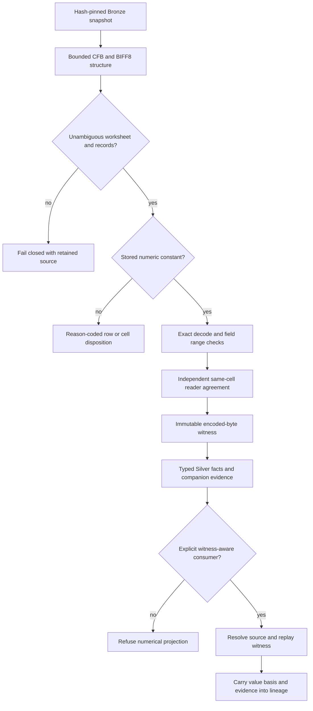

# BIFF8 stored-value evidence contract

This bounded extension admits the retained Budget 2019 expenditure and revenue
pair through a separately versioned source-native Silver interpretation. It
uses the existing Python/xlrd stack, exclusive local package writer, source
operations and explicit native multi-recordset dispatch. It introduces no new
runtime or external service. Earlier OOXML literal-token schemas and consumers
retain their existing contracts.

## Source and numerical boundary

The source census and two-repeat record preflight bind the exact 2019 originals,
headers, definition cells, periods and amount scale. The preparatory observations
contain 319/63 Vote Health rows and 1595/189 required numeric-cell candidates.
Those counts are observations, not a promise that later semantic validation
admits every row. The preflight is not production decoder qualification.

BIFF stores binary numeric encodings. A decoded integer is not an original
lexical token. New facts use `value_basis = biff8_stored_integer/v1`,
`canonical_stored_integer` and `numeric_evidence_id`; they do not populate
`source_number_token` or present a synthesized decimal as source text. Amounts
are exact integers converted without rounding into the source-specific Decimal
carrier. Numeric dimensions also require witnesses before conversion to int64.
The amount carrier's precision/range and each dimension's domain remain
separate checks.

Support NUMBER, RK and MULRK stored constants, including RK signed-integer and
floating-point encodings and the divide-by-100 flag. Decode exactly; fractions,
nonfinite values and overflow remain rejected. Preserve the distinction between
zero, missing and rejected values. Encoded sign and other original bits remain
in the witness even where the canonical integer is zero.

Formula caches never satisfy the constant contract. Any selected-row formula or
spreadsheet error receives a reason-coded rejection. No recalculation, format
conversion or reader-display coercion supplies numerical evidence.

## Witness and package closure

Every emitted numeric field references one unambiguous source-cell witness.
The amount's reference is also on its fact. Witness identity includes decoder
version, source-object hash, Workbook-stream hash, worksheet name and BOF
offset, row/column, record offset/type, MULRK member index where applicable, and
original encoded bytes. Keep a record-payload digest. IDs and output ordering
are deterministic. Reader agreement is an independent cross-check; it does not
prove constant origin on its own.

Readback resolves the witness against the original source bytes, checks the
source and stream hashes, exact worksheet/record/member/cell binding, original
encoded bytes, constant classification and exact re-decoding. It then compares
the result to the canonical stored integer. Self-consistent edited witness
metadata, wrong coordinates, formulas, dangling/duplicate/conflicting references,
fractions and overflow must fail. No witness grants rights or semantic joins.

Use typed, versioned fact and numeric-evidence recordsets plus field lineage
and complete row dispositions. Numeric lineage retains encoded-byte evidence
and its interpretation rule, without claiming original decimal text. Existing
native multi-recordset contracts carry the complete package; single-recordset
consumers must refuse a compound interpretation rather than drop companion
records. The existing exclusive writer writes all Parquet outputs and writes
MANIFEST.json last. Partial packages remain invalid. Dry-run CLI/MCP source
operations remain read-only and redacted.

Preserve existing source/scan/sheet/merged-range bounds. The two-source profile
uses an 8 MiB source/stream bound, bounded BIFF record lengths/counts, checked
CFB stream sizes before extraction, BIFF8 globals/worksheet BOF/EOF, unique
BoundSheet8 names/offsets and an actual worksheet rather than dialog/macro/chart.
Encryption, malformed records, ambiguous mappings and duplicate cell definitions
fail closed. Original source bytes are never rewritten.

## Product integration and qualification

Specify an explicit downstream `value_basis` dispatch and executable mapping
contract alongside the source schema. Existing OOXML consumers retain original
lexical-token/lineage equality checks. A BIFF-aware consumer must replay the
witness, carry basis/reference into canonical/Gold lineage and reject unknown
classes. Existing literal-only consumers cannot accept the new class. This
milestone does not claim that all canonical/Gold consumers are extended; those
remain required follow-up product work under M-10.

Retain source labels, `$000` amount scale, 2015–2018 Actuals, 2019 Estimated
Actual and 2020 Main Estimates, complete row accounting and field lineage.
Currency, period starts, rights, parent/category aggregation and cross-source
comparability/joins remain unqualified. The nine earlier unit gaps and the 2014
revenue edition conflict remain disposition-only. The donor repair ledger is
unchanged.

Qualification uses real fictional BIFF/CFB encoding and refusal fixtures, source
and witness tamper/readback cases, an explicit downstream mapping contract,
repeat builds, complete native output parity and unchanged prior packages. Run
actual CLI/MCP preflights under the existing 30-second cap, the original full
harness with the existing 80% floor/900-second stage cap, exact-head hosted
checks, self-review and normal protected delivery before pruning. Add meaningful
contract tests rather than coverage-target padding.

## Primary record specifications

- [NUMBER](https://learn.microsoft.com/en-us/openspecs/office_file_formats/ms-xls/a40c74c6-3df4-4e81-9a43-85521cc92c0a)
- [RK](https://learn.microsoft.com/en-us/openspecs/office_file_formats/ms-xls/656e0e79-8b9d-4854-803f-23ec62080678), [RkNumber](https://learn.microsoft.com/en-us/openspecs/office_file_formats/ms-xls/04fa5340-122f-49db-93ea-00cc75501efc), and [MULRK](https://learn.microsoft.com/en-us/openspecs/office_file_formats/ms-xls/d125fec1-fc58-4e11-8e87-762a762e0a3b)
- [Formula](https://learn.microsoft.com/en-us/openspecs/office_file_formats/ms-xls/8e3c6978-6c9f-4915-a826-07613204b244) and [FormulaValue](https://learn.microsoft.com/en-us/openspecs/office_file_formats/ms-xls/39a0757a-c7bb-4e85-b144-3e7837b059d7)
- [BoundSheet8](https://learn.microsoft.com/en-us/openspecs/office_file_formats/ms-xls/b9ec509a-235d-424e-871d-f8e721106501), [BOF](https://learn.microsoft.com/en-us/openspecs/office_file_formats/ms-xls/4d6a3d1e-d7c5-405f-bbae-d01e9cb79366), and [WsBool](https://learn.microsoft.com/en-us/openspecs/office_file_formats/ms-xls/ccbd73f9-ff1d-4069-be31-13d16c074ec4)
- [CFB header](https://learn.microsoft.com/en-us/openspecs/windows_protocols/ms-cfb/05060311-bfce-4b12-874d-71fd4ce63aea)
