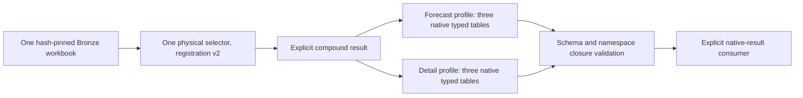

# Compound native workbook results

Status: planned implementation after delivered PR #714. This increment closes
common extraction of the two retained forecast-summary profiles alongside the
reviewed detail profiles sharing their exact source bytes. It does not qualify
canonical measures, mappings, analytical joins, currency, periods or rights.

## Source and output boundary

| Physical source | Native profiles | Facts | Lineage | Profile dispositions |
| --- | --- | ---: | ---: | ---: |
| BEFU 2025 expense workbook, dbde3256… | befu; befu-detail | 10; 80 | 60; 832 | 2332; 84 |
| HYEFU 2024 expense workbook, 725399c0… | hyefu; hyefu-detail | 10; 80 | 60; 832 | 2333; 84 |

The four profiles retain 180 facts, 1784 lineage rows and 4833 profile-specific
cell/area dispositions. Each forecast profile separately excludes two sheets.
These are interpretations of two physical inputs, not 4833 unique source cells.
All 16 existing standalone files remain byte-identical to the retained oracle.

Forecast facts use their existing `SILVER_SCHEMA`; detail facts keep the literal
`FACT_SCHEMA`. Their lineage and disposition schemas also remain distinct.
Neither an inferred union Arrow table nor the canonical health-recordset shapes
is a native carrier. Existing native JSON fields retain their established role;
new facts are not transported as opaque JSON.

## Explicit API delta

Add the following frozen contracts to the existing adapter protocol; leave
`AdapterOutput`, `HealthAdapter` and their existing fields unchanged:

- `NativeRecordset`: exact native table name, schema ID, schema version and
  immutable Arrow table. No shared inferred schema or coercion between leaves.
- `NativeRecordsetContract`: the trusted expected name, schema identity/version
  and complete native Arrow schema, including field and schema metadata.
- `NativeProfileOutput`: native profile ID, named recordsets, complete native
  metadata and explicit excluded-sheet descriptors.
- `NativeProfileContract`: expected profile and recordsets, fact/lineage/
  disposition roles and native record-reference fields. It defines the local
  closure boundary without changing source record IDs.
- `CompoundAdapterOutput`: explicit version discriminator, physical source hash,
  layout, admission status, profiles and physical-source loss descriptors.
  Admission requires every requested sibling. A held result has no profiles
  and an explicit physical-source reason; a successful subset is invalid.
- `CompoundHealthAdapter`: byte extraction returning only the compound variant.

Add a separate `CompoundAdapterRegistration` in existing dispatch code, carrying
its profile contracts and the existing selector metadata. Add
`NativeDispatchResult`, whose output explicitly distinguishes ordinary v1
`AdapterOutput` from the compound variant.

`select_native_bronze_adapter` and `dispatch_native_bronze` accept a tuple of
ordinary or compound registrations. Reuse hash/MIME/probe/ambiguity selection;
validate exact output type and the selected compound contracts before return.
The physical selection receipt stays v1 and records the selected registration's
version; profile/schema identities belong to the compound result.

The signatures, strict registration/output type checks, selection receipts and
return types of `select_bronze_adapter` and `dispatch_bronze` remain unchanged.
Their single-result consumers reject a compound registration or result. There
is no default switch to compound output, implicit sibling omission or automatic
flattening. Native consumers explicitly handle the result discriminator.

`forecast_detail_source_registration` in a scoped source-adapter module binds
one reviewed physical source to both required profiles and a version-2 selector.
It reuses `parse_forecast_snapshot`, literal byte admission/projection and the
existing native schema objects. No source-parser or standalone-writer rewrite
is required. Only these two shared-source registrations get compound variants;
unaffected sources and the existing explicit v1 compatibility route retain
names, versions and output bytes.

A new explicit `compound_workbook_registrations` factory reuses `AdapterContext`
for these two closed contexts; the existing v1 registry stays unchanged. Native
callers choose one registration for each physical source. Supplying competing
v1/v2 handlers is ambiguous and fails closed; the registry does not silently
remove an interpretation.

## Validation and identity

A scoped validator enforces exact known profiles/table roles/schema IDs and
versions, full Arrow schema equality with metadata, unique profile/table names,
bounded output sizes and complete requested siblings. It rejects unknown,
duplicate or missing profile/schema declarations before exposing an admitted
result. It does not repair tables, infer field unions, cast values or promote
source/canonical semantics.

Use source hash + profile + fact-schema ID/version + original record ID as the
lookup namespace. Original IDs in native tables remain unchanged. Fact IDs are
unique within each namespace; repeated IDs in different profiles are retained.
Native lineage and cell/area record associations close against their own
profile's fact table, never a global deduplicated map. Preserve every native
lineage field, raw disposition field, selector/exception list and excluded-sheet
reason. Source fixity and observation context remain explicit per profile.

If either native admission fails, withhold all requested profiles. Preserve the
physical input and a reason-coded held result; do not emit successful siblings.
The implementation must keep source-level selection distinct from profile-level
admission and rights/analytical qualification.

## Evidence and delivery

Use the smallest meaningful synthetic contracts for heterogeneous non-first
fields, nulls, differing decimal scales and Arrow metadata; declared-profile/
schema refusal; local identity/lineage closure; sibling loss preservation;
ambiguous selector refusal; and unchanged v1 caller behavior. Existing validators
and the 80% overall coverage floor remain intact.

Two independent actual-source proofs compare both native siblings for each
physical source, every typed table/descriptor and all 16 historical file pins.
Disclose verified Arrow UTC/parser warmup before dispatch-only Python file-API
denial and deny network throughout. Reports must repeat identically; original
source/reference bytes remain unchanged. Retain failures before repair.

Run the existing focused census checks if a modified file is cited as current
code evidence. `forecast.py` is pinned there and is reused unchanged. Send the
concrete contract/API implementation delta to Conductor before any native/full
launch; Conductor owns serialized execution. Then run the original full harness,
open a focused PR, require seven exact-head hosted successes/resolved threads,
merge normally and verify ancestry/tree/zero-unique/clean state before pruning.
