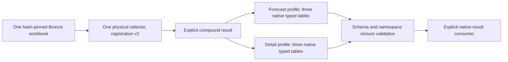

# Compound native workbook results

Status: compound API and source composition implemented after delivered PR #714;
focused contracts, retained-native replay and original full assurance pass;
all initial hosted checks passed; metadata admission review fix requires fresh
native/full and hosted qualification before delivery. This increment closes
common extraction of the two retained forecast-summary profiles alongside the
reviewed detail profiles sharing their exact source bytes. It does not qualify
canonical measures, mappings, analytical joins, currency, periods or rights.

## Source and output boundary

| Physical source | Native profiles | Facts | Lineage | Profile dispositions |
| --- | --- | ---: | ---: | ---: |
| BEFU 2025 expense workbook, dbde3256… | befu; befu-detail | 10; 80 | 60; 832 | 2332; 84 |
| HYEFU 2024 expense workbook, 725399c0… | hyefu; hyefu-detail | 10; 80 | 60; 832 | 2333; 84 |

The four profiles retain 180 facts, 1784 lineage rows and 4833 profile-specific
cell/area dispositions. Each forecast profile separately excludes two sheets.
These are interpretations of two physical inputs, not 4833 unique source cells.
Qualification requires all 16 existing standalone files to remain byte-identical
to the retained oracle. Both actual-source compound dispatch runs now prove
this native parity.

Forecast facts use their existing `SILVER_SCHEMA`; detail facts keep the literal
`FACT_SCHEMA`. Their lineage and disposition schemas also remain distinct.
Neither an inferred union Arrow table nor the canonical health-recordset shapes
is a native carrier. Existing native JSON fields retain their established role;
new facts are not transported as opaque JSON.

## Explicit API delta

Add the following frozen contracts to the existing adapter protocol; leave
`AdapterOutput`, `HealthAdapter` and their existing fields unchanged:

- `NativeRecordset`: exact native table name, schema ID, schema version and
  immutable Arrow table. No shared inferred schema or coercion between leaves.
- `NativeRecordsetContract`: the trusted expected name, schema identity/version
  and complete native Arrow schema, including field and schema metadata.
- `NativeProfileOutput`: native profile ID, named recordsets, complete native
  metadata and explicit excluded-sheet descriptors.
- `NativeProfileContract`: expected profile and recordsets, fact/lineage/
  disposition roles and native record-reference fields. It defines the local
  closure boundary without changing source record IDs.
- `CompoundAdapterOutput`: explicit version discriminator, physical source hash,
  layout, admission status, profiles and physical-source loss descriptors.
  Admission requires every requested sibling. A held result has no profiles
  and an explicit physical-source reason; a successful subset is invalid.
- `CompoundHealthAdapter`: byte extraction returning only the compound variant.

Add a separate `CompoundAdapterRegistration` in existing dispatch code, carrying
its profile contracts and the existing selector metadata. Add
`NativeDispatchResult`, whose output explicitly distinguishes ordinary v1
`AdapterOutput` from the compound variant.

`select_native_bronze_adapter` and `dispatch_native_bronze` accept a tuple of
ordinary or compound registrations. Reuse hash/MIME/probe/ambiguity selection;
validate exact output type and the selected compound contracts before return.
The physical selection receipt stays v1 and records the selected registration's
version; profile/schema identities belong to the compound result.

The signatures, strict registration/output type checks, selection receipts and
return types of `select_bronze_adapter` and `dispatch_bronze` remain unchanged.
Their single-result consumers reject a compound registration or result. There
is no default switch to compound output, implicit sibling omission or automatic
flattening. Native consumers explicitly handle the result discriminator.

`forecast_detail_source_registration` in a scoped source-adapter module binds
one reviewed physical source to both required profiles and a version-2 selector.
It reuses `parse_forecast_snapshot`, literal byte admission/projection and the
existing native schema objects. No source-parser or standalone-writer rewrite
is required. Only these two shared-source registrations get compound variants;
unaffected sources and the existing explicit v1 compatibility route retain
names, versions and output bytes.

A new explicit `compound_workbook_registrations` factory reuses `AdapterContext`
for these two closed contexts; the existing v1 registry stays unchanged. Native
callers choose one registration for each physical source. Supplying competing
v1/v2 handlers is ambiguous and fails closed; the registry does not silently
remove an interpretation.

## Validation and identity

A scoped validator enforces exact known profiles/table roles/schema IDs and
versions, full Arrow schema equality with nested metadata, explicit recursive validation
of non-nullable row fields while retaining allowed nulls, unique profile/table names,
bounded output sizes and complete requested siblings. It rejects unknown,
duplicate or missing profile/schema declarations before exposing an admitted
result. It does not repair tables, infer field unions, cast values or promote
source/canonical semantics.

The non-table envelope has independent limits of 4 MiB, 100000 traversal nodes,
16 levels, 256 excluded-sheet entries across profiles and 64 physical source
losses. Held results obey the same byte/count limits. Supported native metadata
containers/scalars are traversed without copying or coercing their values;
unsupported or cyclic structures fail closed. UTF-8/escaped descriptor costs and
trusted native Arrow schema descriptors also count toward the total output-byte
limit, alongside table buffers. Repeated metadata aliases count per occurrence;
this is not a deduplication rule.

Use source hash + profile + fact-schema ID/version + original record ID as the
lookup namespace. Original IDs in native tables remain unchanged. Fact IDs are
unique within each namespace; repeated IDs in different profiles are retained.
Native lineage and cell/area record associations close against their own
profile's fact table, never a global deduplicated map. Preserve every native
lineage field, raw disposition field, selector/exception list and excluded-sheet
reason. Source fixity and observation context remain explicit per profile.

If either native admission fails, withhold all requested profiles. Preserve the
physical input and a reason-coded held result; do not emit successful siblings.
The implementation must keep source-level selection distinct from profile-level
admission and rights/analytical qualification.

## Evidence and delivery

Use the smallest meaningful synthetic contracts for heterogeneous non-first
fields, nulls, differing decimal scales and Arrow metadata; declared-profile/
schema refusal; local identity/lineage closure; sibling loss preservation;
ambiguous selector refusal; and unchanged v1 caller behavior. Existing validators
and the 80% overall coverage floor remain intact.

Two independent actual-source proofs compare both native siblings for each
physical source, every typed table/descriptor and all 16 historical file pins.
Disclose verified Arrow UTC/parser warmup before dispatch-only Python file-API
denial and deny network throughout. Reports must repeat identically; original
source/reference bytes remain unchanged. Retain failures before repair.

Run the existing focused census checks if a modified file is cited as current
code evidence. `forecast.py` is pinned there and is reused unchanged. Send the
concrete contract/API implementation delta to Conductor before any native/full
launch; Conductor owns serialized execution. Then run the original full harness,
open a focused PR, require seven exact-head hosted successes/resolved threads,
merge normally and verify ancestry/tree/zero-unique/clean state before pruning.

Complete typed native metadata is validated before adding output hashes. Hashes
use the unchanged standalone Parquet encoding in memory; no source or output
file is opened by extraction. A second validation includes the hash descriptors.
Six source-composition checks cover both families, full metadata/table/file-hash
comparison with unchanged writers, atomic admission failure, count drift and
closed registration. Combined focused source/native/literal/registry checks pass
57 tests in 1.91s. These mocked admission fixtures do not qualify actual sources.

## Actual-source and original harness assurance

Conductor owned the serialized native/full run on clean implementation head
`e596ccd2f0f62bf5c42650da16214a43cc62c739`, tree
`10d584b7ed23ff7bf8476f28146c80af671a1f6d`. Two independent runs each
matched all 16 retained native files, separate trusted Arrow schemas and full
native manifest/excluded-sheet metadata. Both reports are byte-identical with
SHA-256 `8dbfc72a39d5d4ee50c6aa60e4fc3b49bf1e375979e4d8ec4a3568bab56f67fb`.
The proof receipt SHA-256 is
`67330d668478f8f23ee99cd4a5021912955b9d3394456797e3597aaf135a129e`.
Native producers, source bytes and reference files remained unchanged.

The original `./scripts/validate.sh` completed all 32 stages: 7,993 tests passed,
12 skipped, 18 warnings, 241.01 seconds; coverage 97.18% against the existing
80% floor. Schemas (66 schemas/56 documents), nine parity cases, mutation,
hygiene and supply-chain gates passed. The original four checker/runtime pins,
four workers, verbose test output and original stage caps were unchanged.
Full log SHA-256:
`0ac469ba7b1f6916ac5e93af03a790255c533533eda5cffe3c0600ea544b7232`.
The owner observed terminal exit 0 and released the kernel guard before these
evidence-only updates. Hosted exact-head checks and protected merge are separate
remaining delivery gates. All wider track semantic/rights gaps remain open.

The portable evidence locator is
`evidence/compound-native-workbooks-20261018`, relative to the existing Health
Appropriations archive root. Machine-specific locations remain in the external
handoff. The original hosted Ubuntu run flagged the absolute locator added in
the final documentation update as a Base64-entropy candidate. Exact comparison
confirmed a local evidence-directory path. The original artifact and failed
job log remain retained; the portable locator correction leaves source code,
tests, native/full proof and scanner policy unchanged. The complete original
secret gate now passes with zero unresolved findings; fresh exact-head hosted
checks remain required.

## Review fix: bind native metadata identity

The final merge guard on ce7913a4 found an unresolved review thread after all
seven checks passed. No merge occurred. A behavioural regression reproduced
admission of both an empty manifest and foreign manifest identity. Preserve
this red evidence and all preceding native/local/hosted results as historical
proof for their exact implementation; they do not qualify the corrected code.

NativeProfileContract now requires an independently supplied
`metadata_schema_version`. Both actual source constructors supply the original
producer envelope ID; it is never copied from candidate metadata. Admission
requires manifest profile/source hash to equal the trusted profile and selected
physical hash, and schema_version to match the trusted producer contract.
Locator/vintage must be nonblank and observed_at timezone-aware. The existing
source_context validator parses these values for comparison with every native
fact row. Original metadata values, timestamp spelling, record IDs, Arrow
schemas and standalone products remain unchanged. The existing source factory
binds locator/vintage to the closed source specification and observation to the
caller context before extraction; this fix does not invent another source
identity authority.

Focused missing/foreign/schema/blank/naive-time and nonfirst-row disagreement
checks, equivalent timestamp preservation, prior compound/envelope/source
checks and unchanged v1 dispatch contracts pass 96 tests in 4.80 seconds.
Ruff and strict typing pass. Fresh actual-source native replay, original full
harness and exact-head hosted checks remain required before resolving the
review thread and merging.
