# Design: New Zealand Health Appropriations Medallion Assimilation

## Bounded quarterly GDP profile

The Stats NZ March-2026 workbook adds a source-specific literal quarterly
expenditure-actual adapter; [its contract](./gdp-profile.md) retains complete
nonempty cell dispositions and separate price/adjustment/unit context. It does
not feed annual Gold ratios or assert canonical semantic promotion. Originals
and other series remain in Bronze, with no source rewriting.

## Source-derived analytical boundary

The bounded Ministry HAIR2024 CSV path emits a distinct
`published_indicator_fact` recordset. Supplied real/nominal/per-capita labels
are preserved without claiming independent reproduction; omitted units, price
base, denominator and exact fiscal dates remain null with explicit quality
flags. These records cannot silently replace calculated Gold measures. The
shared exclusive writer retains original-derived lineage and interrupted
partial outputs; see [Ministry indicator contracts](./moh-indicators.md).

Pure historical/Budget calculations preserve exact values and IDs, partition
sources/vintages, and make period/basis gaps and missing/invalid denominators
explicit. Percentages have an independent Decimal rounding policy; missing
values stay null. See [analytical contracts](./raw-analytics.md). File verification
and exclusive Gold persistence remain distinct from pure computation.

## Design goals

The design makes original bytes durable, transformations reconstructable,
fiscal vintages explicit, publication fail-closed, and every analytical result
traceable to source locations. It extends the repository's existing medallion
contracts instead of building a donor-specific sidecar pipeline.

## System and trust boundaries

### Original-workbook orchestration

The local rebuild command preflights all four known source paths in a
hash-pinned donor manifest and verifies each CAS object before creating output.
One explicit observation timestamp and versioned profile map define the run.
Every run has an exclusively created directory; adapters retain their distinct
schemas and never concatenate unlike record sets. The completion manifest pins
each stage manifest and output hash. Reusing a complete run requires matching
plan identity and full fixity verification. An interrupted or partial run is
retained, not overwritten; retry uses a new directory. This initial complete-run
idempotence contract does not yet claim partial-stage scheduling/resumption.
Structured failure receipts contain stable error classes, not source text or
credentials. No Bronze write, Gold replacement or publication occurs.

Read-only verification is a separate operation, never a call to the rebuild
function. Consumers supply the exact run-manifest SHA-256. Verification checks
that pin before and after inspecting the plan, source CAS objects and all
stage outputs. CLI and MCP share this non-mutating library contract. Missing
or incomplete runs remain missing/incomplete; inspection cannot start work.

Workbook inspection reads one size-capped, hash-verified snapshot. Existing
package/traversal contracts inventory all sheets; bounded previews decode
only a requested head rectangle, without evaluating formulas. Preview values
are labelled decoded displays, not canonical numeric facts. Sheet selection,
row/column limits and an aggregate preview-cell cap bound output. No original
or cached formula value is rewritten, and failures cross the CLI boundary as
redacted classes rather than unstructured source diagnostics.

```mermaid
flowchart LR
    subgraph U[Untrusted and externally mutable sources]
      D[Donor Git repository]
      T[Treasury and Budget sites]
      H[Ministry of Health]
      P[Pharmac]
      S[Stats NZ]
    end

    subgraph B[Bronze - authoritative preservation]
      O[Immutable CAS objects outside Git]
      W[WARC and observation receipts]
      M[Versioned manifests, rights and fixity]
    end

    subgraph V[Validated transformation boundary]
      I[Workbook, CSV, PDF and SQLite inventory adapters]
      Q[Quarantine, tombstone and reason-coded gaps]
    end

    subgraph SI[Silver - source-faithful typed records]
      R[Multi-recordset Parquet]
      L[Field and cell lineage]
      C[Vintage, unit and classification dimensions]
    end

    subgraph G[Gold - rebuildable analytics]
      A[DuckDB models and quality reports]
      X[SQLite compatibility export]
      Z[Deterministic plots and extracts]
    end

    subgraph PL[Platinum - governed projections]
      MD[DCAT, Croissant, RO-Crate, PROV and cards]
      F[Federation and search projections]
      RC[Rights-filtered release candidate]
    end

    subgraph E[External publication boundary]
      HF[Hugging Face dataset]
      COL[HEOR collection]
    end

    D --> O
    T --> O
    H --> O
    P --> O
    S --> O
    O --> W --> M
    M --> I
    I -->|valid and supported| R
    I -->|unsupported, restricted or corrupt| Q
    O --> L
    R --> L
    R --> C --> A
    L --> A
    A --> X
    A --> Z
    A --> MD
    L --> MD
    MD --> F
    MD --> RC
    RC -->|explicit hash-bound approval and credentials| HF
    HF -->|remote readback| COL
```

External bytes are untrusted until streamed, bounded, hashed and recorded.
Bronze objects are authoritative for preservation. All later stores and
indexes are rebuildable. Hugging Face is an external publication target, not
the only preservation copy.

## Layer contracts

| Layer | Authoritative input | Principal output | Promotion gate | Rebuildable? |
| --- | --- | --- | --- | --- |
| Bronze | observed external bytes and donor Git objects | CAS objects, WARC, manifests, rights/fixity/heartbeat receipts | complete byte count, digest and disposition | source-dependent; retained as authority |
| Silver | Bronze objects plus versioned adapter | typed multi-recordset Parquet and field lineage | schema, loss-accounting, unit/vintage and quality checks | yes |
| Gold | Silver records plus versioned transformations | DuckDB models, Parquet marts, SQLite, reports and plots | parity, reconciliation, determinism and query invariants | yes |
| Platinum | Bronze/Silver/Gold manifests and rights state | metadata, cards, federation/search and release candidate | metadata validation, rights and release-readiness gates | yes |
| Published | approved Platinum candidate | HF revision and collection membership | checksum-pinned approval, credentials and remote verification | mirrored from candidate |

## Bronze object and observation model

The [encoded-length contract](./bronze-wire-length.md) compares advertised
Content-Length with HTTPX's raw transport-body counter before decoded CAS
promotion. Already-consumed encoded responses with an advertised length are
unverifiable and rejected; absent lengths are not invented. This does not
change the decoded payload representation or claim raw-socket preservation.

Each immutable object is keyed by SHA-256 and may also carry BLAKE3 and CID.
An observation links a source locator and observation time to an object or a
reason-coded no-object state. Re-observing the same bytes creates a new
observation without duplicating the object. A changed object creates a new
version and explicit predecessor/supersession edges.

The donor import manifest records Git path, mode, blob ID, byte length, object
hash, donor commit/tree and deterministic Git-archive hash. It covers all 23
paths; source data, donor derivatives, code, documents and images are not
selectively omitted.

For ZIP-based workbooks, extraction reads from the preserved package but does
not rewrite it. Package-part inventory can describe formulas, cached values,
styles, relationships, charts, macros and embedded objects while leaving the
original bytes untouched.

Workbook inventory rejects platform-ambiguous member paths and duplicate ZIP
parts before parsing. Existing 20,000-member and 512 MiB expanded-package limits
are supplemented by a cumulative 2,000,000-cell rectangular traversal budget
before formula counting. The cell gate bounds traversal after workbook loading,
not all parser allocation. Rejection leaves Bronze bytes intact and does not
claim that an unsupported workbook was normalized.

The additive `archive-govt-nz.workbook-inventory/v1` output retains the previous
counts and adds sorted package-member names, global and sheet-scoped defined
names, worksheet dimensions, merged/table ranges, formula/comment coordinates
and hidden row/column spans. Formula and comment content is not exported or
evaluated. For formula coordinates only, a second data-only view of the immutable
Bronze workbook records cached-result type and `stored_value`, `stored_error`,
or `missing_or_empty` state. Absent and empty caches are combined because the
reader represents both as null; zero and false remain stored values. Cache
contents are not exported, and `formula_cache_freshness: not_verified` makes
clear that cache presence does not establish freshness or correctness. Workbooks
without formulas skip this second load. Neither view rewrites source bytes.
Unknown package parts are listed without interpreting their payloads. External
workbook references are counted from preserved relationship metadata without
retrieving their targets or exporting target URLs. Embedded/opaque payloads
remain exclusively in the original package. The legacy `has_macros` field is
an exact, case-insensitive `vbaProject.bin` basename marker, not proof of valid
or executable VBA, a full active-content detector, or a safety verdict.
This inventory supports
loss accounting but does not itself claim normalization or source completeness.

## Silver domain model

The opt-in [exact normalization boundary](./recordset-normalization.md) converts
decoded JSON rows into the eight Arrow shapes after local identity uniqueness,
time-order and decimal/null consistency checks. It preserves unknown source
context and does not substitute for source-specific semantic or lineage review.
Bounded JSON-byte admission now rejects duplicate members and binary inputs;
Arrow/Parquet readback reuses the same local invariants after exact metadata
validation. File parsing/fixity and source-semantic promotion remain separate.

The additive [record-set registry](./recordset-contracts.md) specifies eight
versioned structural Arrow shapes without rewriting source-specific v1 tables.
Its bounded Decimal128 carrier preserves representable source values; future
projections must reject overflow, retain source precision and prove semantic
and lineage closure. Unknown valid times are nullable, not invented from year
tokens. Structural schema availability is not canonical source promotion.
Fresh JSON row descriptors mirror these Arrow shapes with fixed-point decimal
strings, explicit nullability and constant metadata. Format validation is
caller-enabled; semantic source and cross-record validation remain separate.

All records share:

- `record_id`, `schema_version`, `recordset` and `domain`;
- `source_object_sha256`, `source_observation_id`, `source_locator` and
  `source_vintage`;
- `valid_time_start`, optional `valid_time_end`, and `observed_at`;
- `rights_state`, `quality_flags`, `transformation_id` and `lineage_id`.

### Record sets and stable keys

| Record set | Example stable key components | Important semantics |
| --- | --- | --- |
| `source_inventory` | object + member/sheet/page/range | coverage, formulas, hidden/unsupported content, disposition |
| `appropriation_fact` | vote + appropriation + department + amount type + financial year + vintage | NZD thousands/millions, estimates versus actuals, multi-category handling |
| `health_spending_fact` | series + financial year + vintage | nominal/real status, fiscal boundary and institutional coverage |
| `fiscal_context_fact` | measure + year/quarter + vintage | GDP and Crown expense definitions, forecasts versus observations |
| `pharmaceutical_budget_fact` | measure + period + vintage | CPB scope and policy/budget period |
| `price_population_fact` | measure + period + geography + vintage | CPI base, wage measure, population definition and seasonality |
| `classification_dimension` | scheme + source label + effective period | mapping version, confidence and drift |
| `field_lineage` | record + field + source coordinate | source cell/range/page, raw value, normalized value and rule |

Missing values distinguish source blank, not applicable, suppressed,
unparseable and absent. Monetary values use fixed-precision decimals at the
declared source unit; presentation rounding occurs only in downstream views.

### Workbook extraction strategy

Adapters are source-family and schema-fingerprint aware:

1. inventory package parts, workbook properties, sheets and dimensions;
2. detect known tables/ranges using labels and structural constraints;
3. retain formula text and cached values distinctly when available;
4. emit raw cell coordinates and typed candidate values;
5. normalize only after unit, header and period validation;
6. reconcile totals and expected row/column constraints; and
7. emit records or a reason-coded exclusion/failure receipt.

No positional heuristic is accepted without a fixture and layout fingerprint.
An unseen layout fails closed for normalization but remains preserved in
Bronze and visible in the inventory.

## Source-specific Silver extraction

### Pharmac medicines-budget HTML

The [bounded Pharmac profile](./pharmac-cpb.md) maps one retained table to
pharmaceutical-budget facts, exact physical-cell dispositions and lineage.
Supplied changes are not recalculated. Source dash markers remain null; empty
layout padding remains preserved. The page's explicit July–June definition
supports dates, while the caption discrepancy and 2022 budget-holder reform
remain visible. Original HTML is not rewritten and rights stay unevaluated.

### Historical source precision and period contract

Historical extraction reads literal numeric tokens from the validated OOXML
package, not a binary-float round trip or the workbook's display format.
The historical record-set schema uses decimal128(38,17), with exact conversion
only; values outside that precision/range receive a rejection, never rounding.
The original lexical token and number format remain alongside the typed value.
This is a separately versioned derivative; existing decimal128(20,3) products
and published files are not rewritten.

Known Health/GDP currency blocks are distinct from percentage-of-GDP blocks.
Year annotations retain marker-to-footnote links. Source labels establish
March/June year-end context; old-GAAP inherits the preceding June context with
explicit lineage while changing accounting basis. No annual start date or
cross-series comparability is inferred. Row-level reconciliation retains donor
values, source values and reasons for omissions/precision differences rather
than using the donor as a source-coverage filter.

### Raw forecast summary increment

The BEFU/HYEFU adapter shares verified-snapshot, exact-number, source-context
and non-overwriting output helpers with the Budget adapter. Source-specific
layout selection remains separate: an exact unique `Health` label, the nearest
preceding same-column `($millions)` label, contiguous consecutive year columns
on the row above the units, and explicit Actual/Forecast labels. Unknown or
ambiguous layouts fail closed rather than selecting the donor's first fuzzy
label match. Forecast-to-Actual reversal within ascending years is rejected.

Only literal selected amounts become facts. Each fact has source lineage for
year, amount, amount type, classification, measure and unit. The separate
formula-based detailed totals remain original content, never evaluated or
silently substituted from caches. Populated cells outside the selected summary
have `preserved_only` dispositions, and selected blank amounts have explicit
rejections. Blank cells outside the selected inputs are not data observations;
their worksheet extents remain represented by the structural inventory. Other
worksheets have explicit preservation-only exclusions.

Profiles select known BEFU/HYEFU sheet names; caller-supplied source vintage,
observation time and original locator accompany the verified object identity.
Financial-year endpoints are not inferred from bare year labels. Rights remain
unresolved until joined to resource-level rights evidence. Output completion
requires a valid manifest and matching hashes in a newly reserved directory.

### Vote Health Estimates 2002/03 revenue increment

The pinned 2002/03 Treasury PDF has a distinct Part F table on pages 43–44.
Its 2001/02 budget and estimated-actual fields and 2002/03 budget field remain
separate in a versioned source-operation profile; the 2003/04
main/supplementary profile is not reused. The registered Bronze adapter emits
the already-reviewed Part B1 detail rows and this Part F revenue profile, with
full-page loss accounting and source-column lineage. The source hash, layout
bounds and row totals are fixed; unsupported layouts remain preserved-only.
This is source-native Silver evidence only: rights, currency, canonical Gold,
annual completeness and cross-source comparability remain unresolved.

## Gold analytical model

The existing SQLite structural inventory now uses encoded literal file URIs and
quoted schema identifiers; see [the bounded repair](./sqlite-inventory-boundary.md).
This preserves the read-only interface but does not add fact extraction,
hash-verified snapshots, concurrent-source guarantees or donor parity claims.

### Raw compatibility export boundary

The source-derived export verifies the entire pinned raw run and its Bronze
objects, then consumes capped hash-verified snapshots of stage facts and field
lineage. It requires unique record IDs, matching source context and exactly one
matching amount-lineage observation per fact. All facts survive projection;
legacy REAL representation differences are flagged beside exact decimal values.
Stable table/record ordering assigns explicit SQLite row numbers to sidecars.

Dry-run is read-only. Writing requires a new exclusive directory outside Bronze
and the input run. Fixed-schema SQLite, exact-value/context JSONL and complete
field-lineage JSONL receive output hashes in a versioned completion manifest.
Failure retains partial files and a redacted error-class receipt; an existing
or partial directory is never overwritten. This is local derivative creation,
not source acquisition, rights clearance, donor repair approval or HF publication.

Gold queries operate over conformed dimensions:

- financial period and source vintage;
- vote, appropriation, category, department and portfolio;
- amount type and forecast/actual status;
- functional and economic classification;
- measure, unit, price basis and denominator; and
- source/institutional coverage.

Derived measures retain numerator and denominator record IDs. Real-series
outputs retain the index series, base period and transformation formula.
Per-capita outputs retain the population definition and temporal alignment.
Revision views compare like measures by vintage; they do not overwrite or
splice vintages.

The donor SQLite database is ingested as a parity oracle, then regenerated as
a compatibility artifact from canonical Parquet. The six donor plots are
validated by query result, series/labels, units, filter choice and rendering
parameters. PNG byte identity is not required across rendering platforms,
though a pinned environment should make release builds deterministic.

## Platinum, federation and publication

### Read-only additive inventory boundary

The additive planner accepts explicit pinned base-manifest, complete-capture,
resource-rights and four versioned Silver-package inputs. It reads capped
verified snapshots, rejects duplicate JSON keys and portable path collisions,
checks every base file, and assigns separate fixed Budget-2026, CPI-2026-Q2,
BEFU-2026 and HYEFU-2025 namespaces. Each package source hash must join exactly
one capture row, resource-rights entry and original file with consistent
locator, recorded rights tuple, object identity and byte count. Symlink inputs
and members are rejected; reviewed local paths are not a concurrent-hostile
filesystem sandbox.

The output is a deterministic proposed payload inventory, not a candidate.
Package manifests retain `rights_state: not_evaluated`; recorded source rights
are evidence joins, not a new rights assessment. Semantic Parquet validation,
metadata overhead, a future candidate root manifest and publication approval
remain explicit separate gates. No files are copied and no HF call occurs.

Platinum metadata derives from actual manifests and schemas. Per-resource
rights determine whether a candidate contains an original payload, a derived
record, metadata only, or a tombstone. Dataset-level cards summarize mixed
licensing rather than replacing it.

Federation exports versioned entity and relationship tables. Candidate joins
to reimbursement and medicines atlases include namespace, identifier,
mapping method, confidence, effective period and provenance. No live sibling
database is required to rebuild this archive's products.

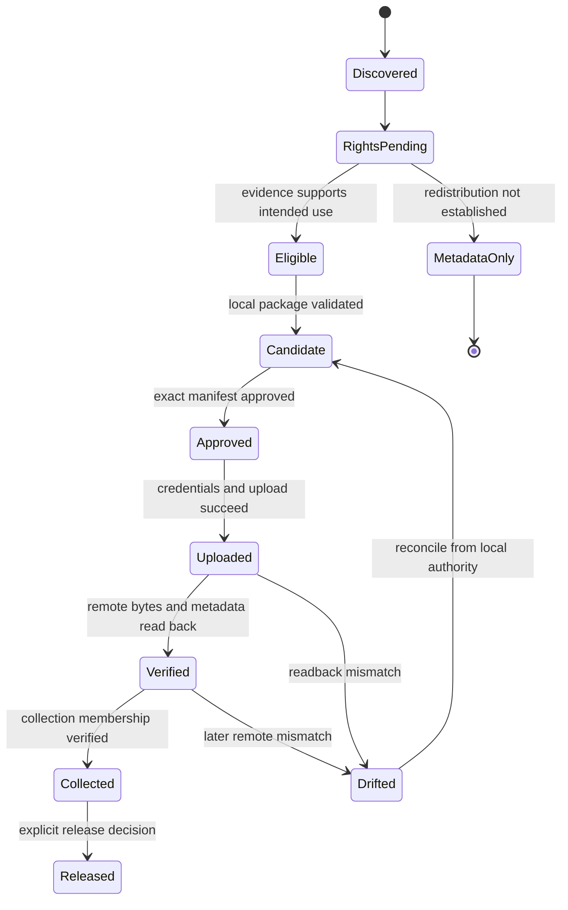

A release claim requires the final `Released` state. `Uploaded`, `Verified`,
and `Collected` retain distinct receipts.

## Operational state and recovery

The fiscal capture runner's bounded cooperative checkpoint/attempt storage
contract is documented in [Bronze checkpoints](./bronze-checkpoint-contracts.md).
It verifies retained CAS/WARC receipts before explicit resume, reserves unique
WARC attempt paths and atomically checkpoints after each resource. The
[process-death follow-up](./bronze-process-recovery.md) now uses a persistent
SQLite exclusive transaction lock: OS ownership ends on process death without
unlinking the shared lock file. Legacy directory locks remain fail-closed.

The existing transactional SQLite ledger records discovery cursors, attempts,
retry schedule, object/observation links and publication stages. Durable
manifests and objects remain sufficient to reconstruct the analytical layers.

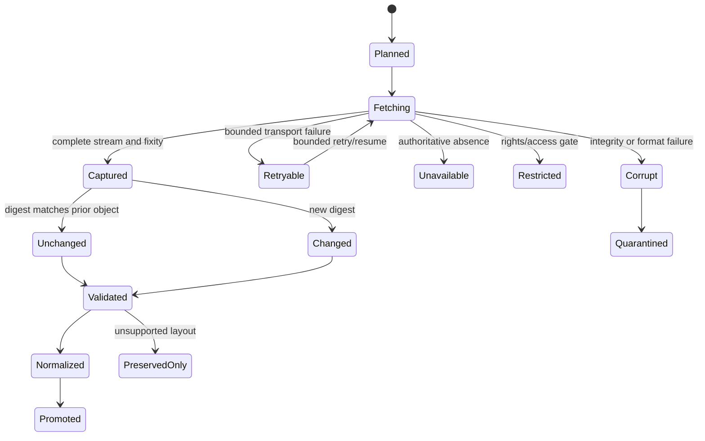

Partial downloads never become captured objects. Atomic writes, bounded
retries, checkpoints and idempotency keys make interrupted runs resumable.
Clean-room recovery starts with an empty derivative store and verifies output
manifest digests after rebuilding each layer.

## Dependency boundary

The current stack already establishes PyArrow/Polars/Parquet/DuckDB patterns.
Workbook structure and PNG plot reproduction may justify `openpyxl` and
Matplotlib. They remain behind an explicit design/dependency task: compare
available repository-compatible approaches, create focused fixtures, amend
`conductor/tech-stack.md`, update the lock, and record licence/security and
reproducibility evidence before production adoption.

## Security and privacy

The bounded embedded-notice observer consumes only three reviewed legacy
workbook hashes. It verifies a capped snapshot, checks exact metadata-cell
decoded-text hashes, and returns a non-eligibility receipt with coordinates and
digests rather than source text. It never follows relationships, modifies
Bronze or registers rights automatically; see [embedded notices](./embedded-notices.md).

Only public government fiscal and aggregate context data is intended. Every
retrieval is size-bounded and type-checked; ZIP packages receive archive-bomb
and path-safety checks. Logs and evidence retain no credentials, signed URLs,
personal information or raw restricted content. Rights and publication logic
fails closed and receives critical-logic coverage, property, mutation and
negative-path tests.

## Design decisions deferred to planned gates

- exact source inventory cutoff and immutable resource URLs after live census;
- adoption/version of workbook and plotting dependencies;
- exact Hugging Face dataset configuration/splits after schema and rights
  stabilization;
- whether aggregate Health Survey linkage has a justified analytical use case;
- whether graph or vector projections demonstrate sufficient consumer value.

## Source-qualified Fiscal share query (2026-10-04)

A verified historical canonical package and its independently verified Fiscal
1972–2025 original supply Health/GDP facts and Core/Total Crown facts. The
query accepts only that source hash/vintage and published unit scales, checks
unique input identities and the source's period/basis definitions, and retains
missing/nonpositive-denominator states. Percentage arithmetic uses an isolated
80-digit Decimal context with half-even rounding to 12 decimal places. Outputs
retain full fiscal periods, numerator/denominator amounts, IDs, coverage and
source flags; the Total Crown denominator never expands the Health numerator.

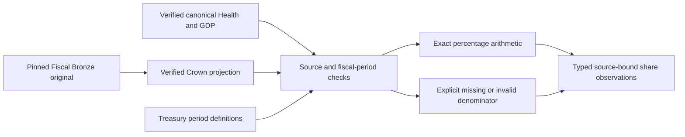

This query performs no source writes or publication and does not change the
canonical source projections. Broader analytical joins require their own
qualified numerator, denominator, period and vintage contracts.

## Pinned annual mean population rate policy (4 October 2026)

Use the verified Fiscal share query's qualified Health rows and the independently
Bronze/Silver-verified DPE056AA annual mean resident projection. Join exact
July–June periods under a named two-vintage policy, retain input IDs and flags,
and report March/missing denominators rather than substituting year-end stocks.
Require both pinned period-observation inputs; keep ISO currency, rights,
publication and uniform census-base assertions outside the derived claim.

## Household CPI fiscal benchmark (4 October 2026)

After original/Silver/canonical verification, select four CPI quarters matching
each qualified March/June fiscal year. Use equal-quarter means and the fixed
FY2025 benchmark under a pinned two-vintage policy. Retain exact canonical
quarter IDs, source time-status labels, source flags and GST/accounting basis.
Bind the official CPI methodology observation and independently check its
2017Q2=1000 reference point. Keep published-index rounding, GST effects and
historical seasonal component changes visible; do not claim a health input
cost deflator or modify original projection qualifiers.

## Fiscal analytical Gold package (2026-10-04)

Keep this derived analytical package separate from the source-separated canonical
Gold contract. Each build reverifies all selected packages through the three
qualified queries. Retain nominal amounts and source qualifications unchanged.
Use exclusive output creation, reject input overlap, and retain partial failure
evidence. Product readback verifies exact inventory, pinned payloads, typed schemas
and bounded expansion; it asserts product fixity without fresh source verification.

## Named Fiscal analytical queries (2026-10-04)

Use the pinned Gold reader before an in-memory DuckDB query. Disable external
access, register only verified Arrow, select fixed SQL and bind bounded limits.
Keep exact Decimal/date encodings and report truncation. CLI and read-only MCP
share the adapter; validate closed MCP input before I/O and redact failures to
bounded codes. Product fixity is separate from original-source verification.

## Fiscal analytical companion reports

A separate versioned package derives six discrete-point plots from pinned Fiscal
Gold. Exact source-linked values remain in structured results. Content-derived
PROV/DCAT projections describe nine base payloads without recursive checksum
cycles; the manifest pins all eleven payloads. Verification is local package
fixity and metadata projection, not source re-verification, rights or publication.

## Fiscal analytical recovery path

The native assurance helper accepts an external archive and an exclusive
derivative root outside it. It pins three originals and three definition
observations before writing, builds each source independently twice, compares
all derivative files and receipts, then rechecks source pins. Console and MCP
queries are independently compared with direct Arrow. It does not inherit
retained Silver or assert rights/publication/full-track completion.

### Budget estimate-transition query

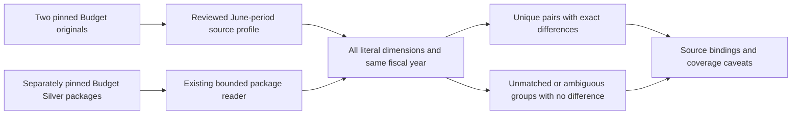

This read-only library query does not rewrite Silver period flags, infer an
agency mapping, aggregate appropriations or approve publication. Fiscal-year
flow dates do not establish the legal duration of a multi-year appropriation.
The exact original hashes qualify the source definitions; native replay audits
source cells separately from the package reader's fixity and contract checks.

### Budget comparison Gold delivery

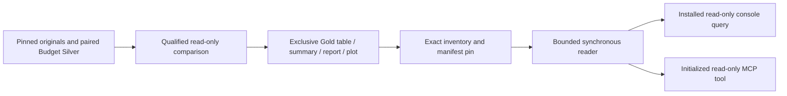

Reader verification establishes package fixity and report projection only.
Source qualifications and caveats remain in every query receipt; semantic
comparability and rights/publication remain unasserted.

### Local analytical Gold metadata boundary

The metadata projection verifies local Gold snapshots only. Source assertions stay
in their pinned Gold package; no source, redistribution, publication or approved
federation assertion is promoted by metadata fixity.

### Local discovery candidate profiles

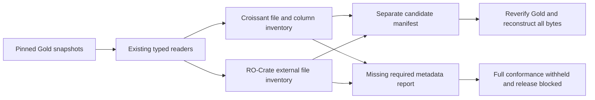

All source payloads remain external. Content identifiers are not download URLs.
Custom Arrow type identifiers preserve exact source representation and make no ML
loader guarantee. Release dates, rights and actors require separate evidence.

### Analytical metadata recovery

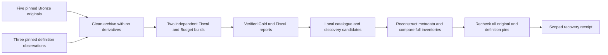

The installed command defaults to source preflight and requires explicit write
for exclusive new outputs. Keep partial failures. Conformance, rights, public
release, additional source families and final whole-track review remain separate.

## Planned canonical Gold row-query boundary (16 October 2026)

The existing canonical Gold verifier checks declared output fixity; a verified
receipt does not establish Parquet semantics or provide data-query delivery.
The next Phase 8 task extends the established named Fiscal query pattern to the
eight existing canonical Gold fact products, preserving source separation.

Require an independent manifest pin and reuse closed package fixity checks.
Read the selected payload into bounded bytes, recheck its declared digest, and
validate its exact existing Arrow schema plus compressed, expanded and row
limits before registering it with an in-memory DuckDB connection. Disable
external database access. Accept only fixed product names and a bounded row
limit, with deterministic source-identity ordering; reject arbitrary SQL.

Return exact Decimal/date encodings, total/truncated counts, product identity
and unchanged source qualifications. CLI and read-only MCP share one adapter
and redacted failure contract. Budget department/portfolio dimensions, CPB
allocation/regime labels and revision/classification caveats remain distinct.
A query over admitted facts neither reverifies Bronze nor establishes new
rights, analytical equivalence, deflator policy or publication eligibility.
This section is the implementation contract, not a completed query claim.

## Canonical Gold metadata profile — 2026-10-17

Extend the existing `gold_metadata` projection with one explicit
`canonical_source_separated` GoldInput profile. Its manifest pin must pass the
canonical package verifier; each declared fact table uses the same bounded,
strictly typed Parquet reader as the named query surface. Metadata must inspect
full admitted tables, not the query API's capped rows. Process table descriptors
without retaining all decoded source tables together. Preserve exact observed
period tokens/counts and Arrow schemas; do not turn tokens into dates or claim
continuous temporal coverage. Existing Fiscal/Budget profile bytes retain their
current meaning and output version. Canonical-containing metadata uses v4 and
source references use v2, with separate schemas and representative fixtures.
Legacy v3/v1 schema bytes and projection bytes remain unchanged; no enum is
widened under its existing identifier. Rights and shape guards remain strict.

Reuse the canonical producer's verified card and RO-Crate as input inventory
references. The existing composite metadata card describes the catalogue; it
does not replace either input artefact. Preserve canonical `rights_state` as an
explicit `not_evaluated` metadata state, and keep publication unperformed.
Reuse existing source-reference extraction only for explicit manifest fields;
absence remains a recorded gap. Metadata is derived from pinned Gold, not new
Bronze/source verification or approval. Graph contexts remain inline/offline;
full standards conformance, Croissant publication requirements and approved
federation relationships remain separate open gates.

The existing Fiscal/Budget CLI metadata build/verify commands and read-only MCP
verifier accept an optional paired canonical directory/manifest pin. Existing
required Fiscal/Budget arguments retain their meaning. Require both optional
fields or neither before reading packages; MCP remains closed and read-only.
Output package counts are exactly two or three. Shared typed input assembly
keeps CLI and MCP pairing behavior aligned; no new runtime or command family is
introduced. Canonical-only projection remains supported by the underlying
GoldInput API; the existing composite CLI preserves its established inputs.

## Fresh canonical recovery inputs — 2026-10-17

The integrated canonical Gold recovery currently reads retained historical
canonical/Silver inputs and rebuilds Budget canonical tables from retained raw
Silver. Replace that input path with an exclusive original-to-raw-to-canonical
builder consuming only five hash-pinned Bronze objects and locked source
observation definitions. Definitions include the exact original timestamp
input token and expected source observation ID; normalization to an equivalent
UTC spelling must not silently renumber old observations. Capture/local
processing observation context is replayed, not newly attested HTTP capture.
No runtime definition is inferred from retained derivatives.

Build two independent input trees, compare raw/canonical inventories, and bind
each Gold build to its corresponding fresh input tree and the corresponding
already-rebuilt Pharmac/MoH/BEFU/HYEFU inputs. Fiscal Crown remains direct from
its pinned original. Keep partial attempts without a completion receipt on
failure and never overwrite outputs or originals. Preflight all source pins
and token identities before creating the output tree, then recheck originals.

The preflight found equal selected values/qualifiers/lineage/dispositions for
all five sources. Historical 2025 and three Budget profiles used exact `Z`
tokens, while manifests store equivalent `+00:00`; the original token reproduces
the observation ID. Exact historical-2025 replay is byte-identical. Current
Budget normalizers additionally emit adapter-selection evidence; retain that
new evidence and report provenance deltas rather than stripping it to force an
old manifest digest. No source-value replacement or identity-algorithm change
is authorized by this repair.

Exercise named canonical queries over both rebuilt Gold packages with exact
independent Arrow row/count readback and deterministic receipts. Reconstruct
metadata from the fresh canonical Gold and fresh Fiscal/Budget Gold inputs,
including the new v4/v2 canonical-containing projection; compare inventories,
reverify metadata bytes and preserve all unqualified rights/standards states.
This closes supported reconstruction paths, not missing source profiles, rights
decisions, publication authority or the final track review.

## Observation-preserving capture inventory

Independent capture cohorts project into a URL-indexed inventory while retaining
all original census and capture rows, source-ID aliases and distinct content
versions. Input pins bind exact serialized metadata; resume receipts bind the
original request hash and URL identity, never a fabricated post-capture census.
Legacy request-context gaps remain explicit. Projection, native CAS verification,
WARC replay, rights qualification and analytical admission are separate claims.
See [the bounded inventory evidence](./capture-inventory-20261017.md).

## Reviewed overview operations and pinned readback

Fourteen existing main overview profiles use their common Bronze registrations
and actual DispatchResult records/lineage/losses. A source-specific bridge
projects those records into the existing three Parquet schemas, preserving
stable IDs, values and table bytes. Original losses and AdapterSelection remain
in a closed versioned extraction manifest; compatibility projection explicitly
records preserved_only to preserved_unreviewed and the legacy2016 reason.

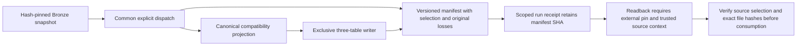

The compact source-operation/v1 receipt stays closed and still reports only
three Parquet hashes. It does not authenticate embedded selection. Later
readback requires the manifestSHA retained by the scoped run/recovery receipt;
it cannot derive its own authority from the manifest under inspection. Partial,
extra, symlink, tampered, wrong-context and unknown-version outputs fail closed.
Existing direct APIs and2002 composite ownership remain unchanged; no new
rights, numerical admission or external publication behavior is introduced.

## Reviewed forecast common adapters

The two versioned BEFU2026/HYEFU2025 summary registrations reuse one pure,
bounded in-memory extraction boundary factored from the existing forecast
normalizer. All four legacy/versioned filesystem APIs retain their original
receipts, tables and default write behavior. Only the two explicitly named
successors enter the common registry; neither legacy generic alias is added.

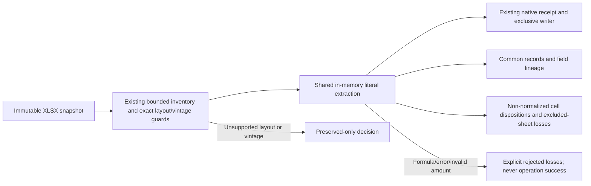

Actual/Forecast headers, source vintage, unit labels, financial-year-basis gaps,
lineage and all non-normalized inputs remain explicit. Common selection is not
an operation success status. Current source operations remain on the existing
native route for these profiles; their partial-result refusal is unchanged.
No formula evaluation, cached-total admission, pooled series, inferred currency
qualification or external mutation follows from registration.

## Reviewed forecast operation adoption — 2026-10-17

Only BEFU-2026/v1 and HYEFU-2025/v1 source operations change routes. A verified
bounded Bronze snapshot feeds the existing explicit registration/dispatcher.
Facts and six-field lineage come from its actual output. The same immutable
snapshot is parsed through the shared native parser to recover raw cell types,
JSON values, record links, workbook inventory and selected coordinates absent
from the common loss protocol; facts, lineage and every loss must reconcile
exactly before projection. No direct filesystem normalizer delegation occurs.
The three Parquet tables remain byte-compatible; a new versioned operation
manifest retains canonical selection, common losses and this explicit projection.
The compact public source-operation/v1 does not authenticate that manifest.
Readback requires a separately retained manifest SHA and trusted exact
source/context/profile; it regenerates expected outputs and verifies exact files,
metadata, table pins and final manifest stability. Symlink ancestors are refused
before work; existing or interrupted destinations cannot be overwritten.
Rejected cells yield partial metadata. Default preflight writes nothing and
reports compact failure; explicit writes retain the four-file partial package
and still report compact failure. Selection never implies successful operation.
The four native APIs and their original manifests stay unchanged.

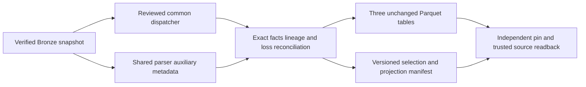

## Five context operation profiles — 2026-10-17

CPI CSV, annual population CSV, QES Table8 and both GDP workbook vintages retain
separate explicit registrations and source contexts. Operations consume their
actual common records/lineage/losses plus all unresolved dimension assertions and
links. Persist original common evidence in a versioned operation manifest; a
source-specific compatibility projection emits the three existing native Parquet
tables without changing the direct native APIs. Source row status, rules, labels,
qualifiers, null targets and evidence must not disappear in projection.
The recorded CPI vintage label differs from the existing common caller label;
any supported alias must be explicit and evidence-bound, preserving the observed
literal rather than silently rewriting facts. Population common raw records and
three-field lineage differ from legacy canonical facts/two-field lineage; retain
both representations and describe any legacy-rule projection. GDP June facts
retain their June transformation/vintage even where the existing family parser
layout token retains its earlier label. QES's existing passed preflight token and
compact public behavior remain explicit. None of these metadata projections is
an approved comparison, denominator, fiscal alignment, currency or rights claim.
Regenerate expected metadata/table bytes from bounded immutable source snapshots
before writing. Independent readback requires a retained external pin, exact
source-derived bounds, canonical metadata, exact files/table hashes and final
manifest stability. Refuse malformed inputs, symlink ancestors, stale/partial
or changed evidence without repairing or overwriting it. All current source and
reference hashes remain immutable. Four native references survive; June GDP has
independently recorded four-file pins and verified Bronze, requiring a bounded
reference materialization before actual common-operation parity.

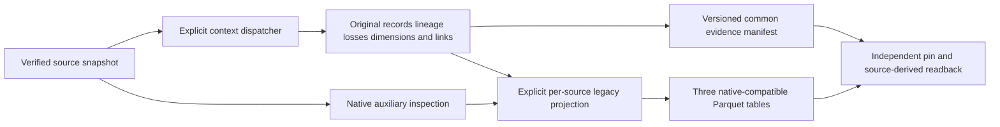

Historical June GDP recovery retains its native schema and independent four-file
pins through the unchanged native API; a new operation manifest cannot replace
that canonical-reader cohort. Qualify the whole outer recovery report against
retained evidence. Adoption of common-operation packages by downstream canonical
consumers remains a distinct integration task; historical pins are never relaxed.

## Operation-bound canonical context — 2026-10-17

Canonical consumption requires an independently retained operation manifest pin,
exact reviewed source/profile/vintage/locator/observation identity, and the full
source-regenerated operation verification. Return verified source-derived typed
tables and original common evidence together; canonical transforms must not
reopen unauthenticated candidate files. Reuse pure canonical transformation logic
from the existing native readers without relaxing their fixed historical pins.
Preserve canonical facts and direct lineage, including QES v2 schema and GDP
release-specific transformation. A distinct projection receipt binds the actual
operation schema/pin and common-evidence digest; it does not impersonate a native
extraction receipt. No-write projection returns typed tables and evidence.
Source-separated Gold consumption follows this canonical qualification and must
retain explicit source statuses rather than infer them from periods. Existing
native Gold products and their evidence remain reproducible.

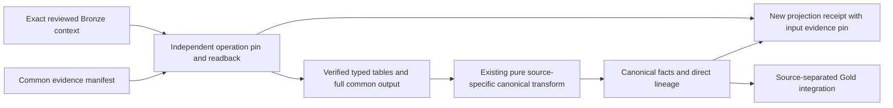

QES legacy canonical lineage is a retained historical representation: its six
mapping fields exist but required common metadata is null, so schema validation
and Parquet serialization fail. The new operation route retains the legacy table
digest using canonical JSON plus its serialized Arrow schema, preserves all 90
mapping tuples, and completes mandatory metadata from uniquely resolved verified
canonical targets. Stable per-field IDs and an explicit completion transformation
make this a source-backed disposition. Fully validate both v2 tables. Never change
the historical reader/output or relax admission to claim byte parity with invalid
lineage; all other source lineages and all fact values retain full parity.

## Source-regenerated operation Context Gold — 2026-10-17

Admit all five exact reviewed operation profiles through the independent-pin
canonical reader. Keep source/vintage groups separate; no pooling, deflation,
annualization, currency inference, denominator or analytical join is performed.
Reuse existing context observation/coverage/quality schemas and deterministic
report/plot projections; preserve original native Gold producer/readers. Bind a
distinct operation-Gold manifest to canonical projection receipts and complete
common-evidence input pins. Population publisher status comes from actual common
source records, never a period guess. Existing native output remains historical;
record any source-backed metadata/status difference explicitly.

Compute all expected product bytes and metadata from verified inputs before any
write. Default to no-write preflight; explicit local writes reserve a new directory
and preserve incomplete output. Refuse symlink ancestors and output/source/input
path overlaps. Independent readback requires a retained Gold pin AND trusted
input-operation pins/source context, regenerates the expected product closure,
and verifies exact metadata, files, bytes, source controls and final manifest
stability. Candidate declarations never authorize a source or set read limits.
Typed CLI build/verify and read-only query flows use that same boundary.

The preferred SharePoint structured-document route was evaluated first for the
quality report. Microsoft's current documentation describes a Word (.docx)
template stored in a SharePoint library, with Copilot licensing/edit prerequisites
and generated documents written to that library. This Gold report is an existing
Markdown machine artifact inside an offline, byte-stable Bronze-rebuild hash
closure; that cloud document route does not satisfy its format/offline/external-
mutation contract. Reuse the existing quality renderer, without a new document
runtime or a tenant/licensing change. This is not a finding about tenant-wide
availability. No qualified SharePoint template/flow route was found in the repo.
Source checked 2026-10-17: [Microsoft structured document generation](https://learn.microsoft.com/en-us/sharepoint/copilot-in-sharepoint-structured-document-generation).

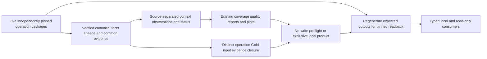

### PR #704 reserved-output substitution correction

An actual first-write/between-write regression reproduces18+unexpected files
added to an input package through a substituted output symlink. Retain source-
regenerated products before reservation, but bind all creates to the reserved
directory object, with exclusive creation and finally-close.
POSIX uses dir_fd; Windows holds native list/read-attribute directory handles on the
complete lexical ancestor chain and reserved leaf, with FILE_SHARE_READ only
(no write/delete sharing), reparse/junction rejection and128bit file-ID checks.
The native qualification must prove path protection through child creation/readback,
rather than reuse
Budget's unlocked path-only fallback as proof of race protection. Path identity
and symlink guards remain before/after writes and final readback; interrupted
output stays separate and is never repaired. Exact bytes/manifest identities
must remain stable. Native references checked2026-10-17: [Microsoft CreateFileW](https://learn.microsoft.com/en-us/windows/win32/api/fileapi/nf-fileapi-createfilew)
directory/reparse flags and sharing semantics, GetFileInformationByHandleEx
FileIdInfo/AttributeTagInfo, and Python3.14 Windows128bit st_ino. Platform
support still requires actual hosted Windows contracts before delivery.

Windows qualification at4a3cad55 disproved attribute-only sharing protection:
two native replacement tests allowed rename. Microsoft [MS-FSA sharing checks](https://learn.microsoft.com/en-us/openspecs/windows_protocols/ms-fsa/8c0e3f4f-0729-49f4-a14d-7f7add593819)
apply to read-data/list-directory, write-data, execute or delete access, not an
attribute-only handle. Require FILE_LIST_DIRECTORY|FILE_READ_ATTRIBUTES (0x81)
with the existing share/read-only mask; qualify actual Windows behavior before
claiming protection. Run the existing tiny native output-pinning contracts before
long Windows CI assurance so this failure is caught early. Required full platform
gates, assertions, coverage80%, dependency pins and timeouts remain unchanged.

### Operation-context Platinum metadata and recovery adoption

Reuse gold_metadata's existing renderers and projections through an explicit
new typed input profile carrying the retained Gold pin, five operation pins and
trusted source root. Obtain verified expected manifest/product bytes from the
same source-regenerated Gold boundary after saved-package readback; do not reopen
unauthenticated candidate Parquets. Keep historical v3/v4 profile bytes stable
and version the new profile. Inventory all actual13 Parquet schemas/row counts
and report/plot payloads; preserve exact period tokens with no inferred coverage.

Record null publisher-status counts explicitly alongside nonnull literal status
counts; do not convert null to an invented source status. Distinguish canonical
facts, field lineage, observations, coverage and quality record kinds. A descriptor
for lineage is not a source-observation count. Cards must describe source
reverification per profile accurately; the older snapshot-only profiles retain
their existing statement. Source references come from exact manifest field paths;
missing reference fields remain explicit. Local paths must not appear in output.

Retain independent metadata/input pins and no-overwrite/partial-output behavior;
protect Bronze, operation and Gold roots and symlink ancestors. Reuse bounded
exact membership and source-regenerated byte limits for readback. Demonstrate
historical metadata parity and two complete Bronze→operation→canonical→Gold→
metadata repeat builds, with unchanged originals. Rights stay not_evaluated,
publication not_performed; emit no federation links or full standards-conformance
claim. The machine-readable offline contract reuses the existing renderer and
previously evaluated structured-document route limitation.

### CPI source-evidence census reconciliation

Reuse the existing context-census June2017 reference qualification and
fiscal_cpi_benchmark policy. Current generic CPI v1 products deliberately retain
source-only base annotations; historical bytes and pins remain unchanged.
The remaining work is a reproducible metadata/source provenance join, not another
fiscal benchmark. Use independently retained exact body/WARC pins for the official
June2026 release, version159/current DataInfo+ HTML/JSON and Stats NZ copyright
page, plus the existing original CPI CSV. Compare edition identifiers and literal
source fields without treating SDK IsPublished as a rights or access decision.
Retain both raw snapshots when a metadata identifier differs.

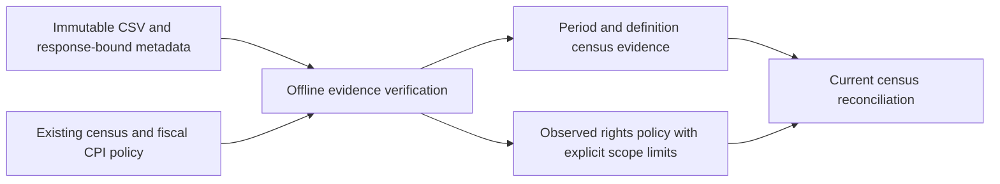

Derive the expected quarter-label grid independently of observed values; report
missing labels separately from publisher NA slots and never fill values or infer
continuous numeric coverage. Preserve exact URLs, edition, units, definitions,
qualifiers, field coordinates and provenance. Store source payloads/WARCs outside
Git; repository evidence contains only metadata and digests. Rights-policy
observations do not automatically approve redistribution of every related host
or resource. No new source admission, joined measure, publication or schedule is
implied. Add only meaningful success, changed-pin/link/binding and period-gap
contracts; replay from retained Bronze and preserve the80% coverage floor.

The inspector accepts only body/WARC storage roots; the reviewed seven capture
pins, byte limits, URLs, media and observation contexts are fixed in code.
Read both artifacts as bounded regular immutable snapshots. Factor the existing
WARC verifier into a byte-snapshot entry and keep its Path wrapper, avoiding a
candidate reopen while preserving every existing binding/framing check. Ignore
unrelated frontend widgets and require one page-state object with the expected
release fields. Keep JSON duplicate/type checks and distinguish absent/null
metadata fields; only the observed spatial-identifier difference is supported.
Actual-source proof must precede the current census evidence update; retain a
historical census snapshot if its current metadata changes. Final full assurance
runs only after that coherent reconciliation, under the existing launch owner.

### CPI source-health evidence adoption — 2026-10-17

Reuse the existing source-health producer/renderer/build tool. A typed optional
CAS/WARC input regenerates the fixed source-evidence profile and must match
independently pinned report0716432e. Census bytes must decode to the supplied
censuses; exact CPI census identity, series, source/body and vintage bind the
enrichment. Source observation timestamps remain observations. Only explicit
evidence emits v2; v1 outputs remain byte-identical for the same inputs.

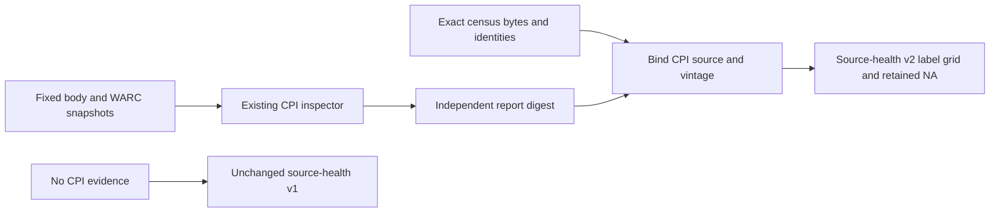

Zero absent quarter labels is not numeric continuity, freshness, rights, fiscal
alignment or analytical admission. Other context/resource rows retain their
states. Historical reports remain separate; new tool outputs must use distinct
paths. Conductor reviewed this design without a blocking gap; broad/native
launch ownership remains with the coordinator.

### Operation-context metadata operations — 2026-10-17

The existing metadata CLI/MCP verifier requires Fiscal/Budget inputs and exposes
v3/v4, while the qualified source-regenerated operation-context API emits v5.
Add explicit typed v5 build/verify CLI routes and one read-only MCP verifier,
using the existing five-profile input-spec reader, trusted Bronze root and
independently supplied Gold/metadata manifest pins. Build remains dry-run by
default; even dry-run regenerates Bronze-derived Gold/metadata before success.
Write invokes the existing immutable output guard and post-write verifier.
Repeat builds use fresh directories; existing different/partial outputs are
never overwritten. Verification performs no writes and regenerates expected
products instead of trusting a self-consistent candidate manifest.

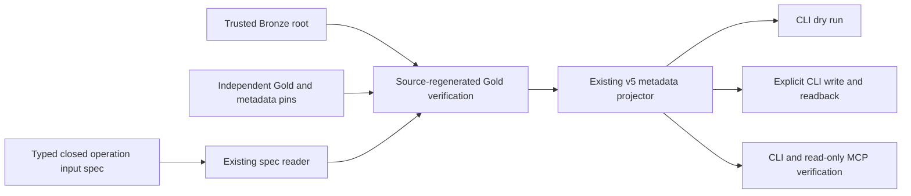

Preserve existing v3/v4 contracts. New MCP output is v5/packages1 only, with
source-regenerated verification scope, rights not_evaluated and publication
not_performed. Refuse source/Gold/output overlap and prove byte/membership
immutability during verification. No new renderer, source acquisition, consent,
schedule activation, publication or analytical join is introduced. Conductor
reviewed this bounded design; broad/native launches remain coordinator-owned.

### Component-index source census qualification

Extend the existing offline source-evidence pattern for the exact retained LCI
and PPI export cohort, not a generic Infoshare scraper or analytical policy.
Immutable source/query and actual HTTP-response digests select the cohort;
verify bounded snapshots and existing WARC response binding before interpreting
CSV periods, lexical decimal values, explicit missing tokens and metadata.
Publisher TQX is selection configuration only, separately pinned and compared to
table/dimension/period identity; it never supplies numeric observations. Preserve
LCI Central Government versus PPI industry-input scope, social-assistance scope,
distinct bases and publisher vintages. Retain method/ownership/copyright evidence
separately from legal decisions and analytical eligibility. No full alphanumeric
series identifier, FINAL flag, annual join, currency or health-cost basket is
inferred. Output is deterministic source-census evidence; existing Silver/Gold
and generic host rights policy remain unchanged. Focused refusal contracts must
cover source/response mismatch, selection/header/period drift and numeric/gap
semantics; actual-source offline repeats and the repository harness precede PR.

### Common Supplementary summary dispatch

The two existing2024/25 and2025/26 normalizers and common Bronze adapters share
one pure snapshot extraction boundary. Edition-specific parsers and exact byte,
locator, vintage and page controls remain authoritative; no generic PDF layout
heuristic is added. Native fact/lineage construction feeds unchanged standalone
Parquet outputs and the common AdapterOutput. Registry entries remain explicit,
sorted and ambiguity-rejecting. Source pages/content outside the reviewed summary
are loss-accounted without claiming whole-page normalization. Exact source units,
capital-injection flags and dash nulls remain literal; currency, classification,
rights and analytical joins are unasserted. Compare old/new standalone products
and common records/lineage before native/full/hosted delivery.
