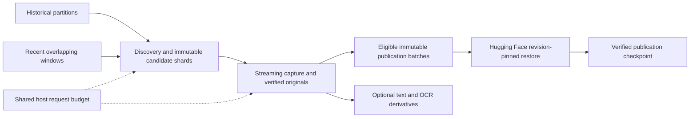

# Design

Use separate collection/partition cursors and single-owner leases, with one catalogue writer or revision-conflict rejection for the shared Hugging Face index. Advance discovery only after durable candidate shard persistence; advance capture only after complete hash-verified atomic object admission; advance publication only after remote restore. Uploaded-but-unverified batches remain recoverable pending work.

Partition first by verified Parliament/committee/business and date filters. Do not rely on changing offset pages alone: retain overlap, page fingerprints and stable-ID deduplication. Record terminal-page evidence and reconcile boundaries before claiming partition completion. Current evidence and submissions/advice index totals differ; do not sum them.

Proposed initial bounds are 100 records, 250 MiB or 15 minutes per run, plus per-file/spool limits, one active request per host and approximately one request per second. Honour access rules and Retry-After; defer throttled work. These are pilot settings, not measured capacity. Extra streams cannot multiply server load.

Store source IDs, version observations, attachment relationships and checksums separately from content-addressed original objects. Shard metadata by collection/partition and immutable batch. Qualify small-file packaging before scaling. Reclaim spool bytes only when remote recovery and the selected retention policy permit it. Durable state must survive ephemeral CI workers and artifact expiry.

Rights-pending records branch to an explicit eligibility queue. Only approved eligible payloads enter publication; public availability is not a blanket reuse licence. Handle replacement, withdrawal and restrictions without silent historical overwrite. Use synthetic/redacted fixtures.

Existing CAS, capture/WARC, source-set and Hugging Face components are reuse candidates, not proof of end-to-end readiness. Preserve current dataset metadata; resolve the exact target before any upload. No new service/runtime is selected.

## Qualified implementation boundary

The report adapter now reuses existing streamed capture and CAS components, with a SQLite ledger and process-lifetime lock in one shared state root. Historical and recent report discovery have independent cursors; recent rescans first pages, historical resumes its cursor. Every report API response is retained as original metadata, including metadata-only rows. Closed response contracts fail on unknown fields. Per-observation snapshots prevent new metadata relabelling old bytes.

Publication is constrained to `edithatogo/archive-govt-nz-global`, requiring anonymous public and ungated readback. V2 immutable manifests include software fingerprint, original metadata/payload distinction, eligibility and capture state. Existing v1 batches remain intact. Unknown commit outcomes are recovered by checking the immutable namespace, never repeating a blind mutation. Acquisition and publication have separate checkpoints; the acquisition time bound does not prove a whole-run publication deadline.

Unresolved: legacy crawling denied; submission/advice reuse excluded from general licence; full reconciliation and natural scheduling pending. No track completion or full-site coverage follows from the report pilot.
